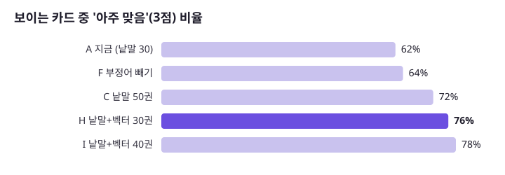
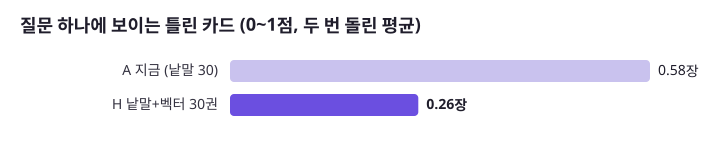
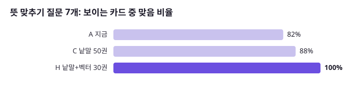
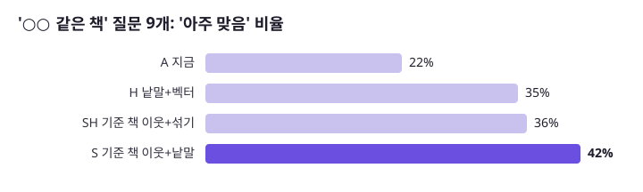

# AI 책 찾기 강화 실험: 무엇이 얼마나 나아지나 (2026-10-25)

> **이 문서의 역할**
> - 답하는 것: 2026-10-25에 후보 뽑는 방법 9가지(A~I)와 「○○ 같은 책」 방법 2가지(S·SH), 2차 지시문 v2를 **같은 질문·같은 채점표**로 재서 무엇을 넣고 무엇을 버렸나. 그리고 고른 방법(H·S)을 백엔드 코드에 넣은 뒤 다시 잰 숫자(4-1절).
> - 답하지 않는 것: 이 뒤에 더 해 본 안 8가지와 책 분류 사전 → [개선 보고서](2026-10-25-improvement.md). 질문 벡터 모델을 줄인 과정 → [임베딩 시험 보고서](2026-10-25-embedding.md). 지금 흐름 → [1-how-it-works.md](../1-how-it-works.md). 버전별 변화 → [2-versions.md](../2-versions.md). 모든 숫자 모음 → [4-portfolio.md](../4-portfolio.md).
> - 그때 운영 버전: v1.14.x(AI 검색 흐름은 v1.12.0~v1.13.2와 같음. v1.14.x는 「책첵 추천」만 바뀜). 1차 Haiku가 검색어를 뽑고 → 낱말 검색 30권 → 2차 Haiku가 고름. 대상 책 30,939권.
> - 지금과 다른 점:
>   - H(낱말 + 벡터)와 「○○ 같은 책」 이웃은 [v1.15.0](../2-versions.md#v1150)부터 운영. 다만 운영이 넣은 「○○ 같은 책」은 이 문서의 **SH**(이웃 먼저 + 나머지는 H 순서)이고, 표 「한눈에」의 S(이웃 먼저 + 나머지는 낱말 순서)가 아닙니다(4-1절은 SH와 비교). 이름 댄 책도 지금은 「같은·비슷·처럼·류의·풍의」 바로 앞 글에서만 찾습니다([1-how-it-works 4-6절](../1-how-it-works.md)). 이 실험의 S·SH는 질문 어디에든 들어 있는 가장 긴 책 제목을 썼습니다.
>   - [v1.16.0](../2-versions.md#v1160)부터 1차는 Haiku가 아니라 질문 벡터 위 작은 신경망(ML 1차)이라 검색어는 질문 낱말 그대로이고 핵심어는 없습니다. RRF 점수에 칸 보너스(맞은 칸 하나에 0.004)가 더해집니다.
>   - 질문 벡터는 백엔드가 아니라 임베딩 전용 서버가 만들고, 대상 책은 76,759권(책 벡터 81,078권)입니다([2-versions 「10만 권 데이터」](../2-versions.md#10만-권-데이터)).
>   - 2차 지시문은 그 뒤 v1.16.1~v1.19.0에서 여러 번 바뀌었습니다. 여기 3-4절의 「v2」는 이 실험의 2차 지시문 고침이고, v1.18.0의 「되묻기 v2」와 다른 것입니다.

책첵의 「AI 책 찾기」를 강화할 방법 7가지를 **같은 질문 50개(+비슷한 책 질문 7개)로 재현해 숫자로 비교**했습니다. 그때 운영 코드와 같은 규칙으로 후보를 뽑고, 그때 운영과 같은 지시문으로 AI가 고르게 한 뒤, 사용자에게 보일 카드를 별도의 심사 모델이 0~3점으로 채점했습니다.

## 이 문서에서 쓰는 이름

모두 `scripts/aisearch/eval/cands.py`·`cands_sim.py`에서 확인한 계산입니다. 「낱말 후보」 = 1차 Haiku가 뽑은 검색어로 `search_text`에 `LIKE '%낱말%'`을 걸어, 핵심어가 많이 든 순 → 맞은 낱말 수 → 내 도서관 수 → 책 번호 순으로 세운 목록. 「벡터 후보」 = 질문 벡터(1,024차원, 길이 1)와 책 벡터(같은 모델, 길이 1)의 내적(= 코사인)이 큰 순. 「RRF」 = 목록마다 책의 순위 r(1부터)에 1/(60 + r)을 주고 두 목록 값을 더해 큰 순으로 세움.

| 이름 | 후보를 만드는 계산 | 후보 수 |
|---|---|---|
| A 지금 | 낱말 후보 앞 30권(그때 운영과 같음) | 30 |
| B / C | 낱말 후보 앞 40권 / 50권 | 40 / 50 |
| D | 낱말 후보 60권에서 제목(글자만)이 같은 책은 하나만 남겨 앞 30권 | 30 |
| E | A 30권 + A의 앞 5권 각각의 이웃(`foryou.book_neighbour`)을 1번째 이웃부터 돌아가며 10권 | 40 |
| F 부정어 빼기 | 1차가 따로 뽑은 「뺄 말」이 든 책을 낱말 후보 맨 뒤로 보낸 앞 30권 | 30 |
| G 벡터만 | 벡터 후보 앞 60권에서 같은 제목 하나만, 앞 30권 | 30 |
| **H 낱말 + 벡터** | 낱말 후보 50위와 벡터 후보 60위를 RRF로 한 줄로 세움 → 같은 제목 하나만 → 앞 30권 | 30 |
| I | H와 같은 계산으로 앞 40권 | 40 |
| **S 기준 책 이웃 + 낱말** | 질문(글자만)에 들어 있는 가장 긴 책 제목을 「기준 책」으로(같은 제목의 모든 판). 그 판들의 이웃 가운데 내 도서관이 가졌고 제목에 기준 책 이름이 없는 것 최대 20권 → 그 뒤를 A 순서로 채움 → 같은 제목 하나만, 30권 | 30 |
| SH 기준 책 이웃 + H | S와 같은 이웃 최대 20권 → 그 뒤를 H 순서로 채움 → 30권 | 30 |
| v2 | 후보는 A·H 그대로, 2차 지시문만 고친 판(3-4절) | 30 |

이 문서의 「지금」은 실험한 날(2026-10-25)의 운영, 곧 A입니다. 「섞기」는 H(위 표의 RRF 계산)를 가리킵니다.

## 한눈에

| 바꾼 것 | 숫자로 본 효과 | 비용 | 판단 |
|---|---|---|---|
| **H 낱말 검색 + 벡터 검색 섞기 (후보 30권 그대로)** | 「아주 맞는 카드」 **62% → 76%**(두 번째 75%), 틀린 카드 **0.58 → 0.26장/질문 (−55%)**(두 번 평균), 뜻으로 묻는 질문 맞음 **82% → 100%** | 2차 입력 그대로. 질문 벡터 1회(서버 int8 기준 중간 106ms) | **넣을 것** |
| **S 「○○ 같은 책」은 그 책의 이웃 책을 후보로** | 「아주 맞음」 **22% → 42%**, 맞음 71% → 79% (질문 9개) | 그대로 (이웃은 이미 계산돼 있음) | **넣을 것** |
| C 후보를 30권 → 50권 | 「아주 맞음」 62% → 72% | 2차 입력 **+66%** | 섞기가 더 싸고 더 좋음 |
| v2 2차 지시문 고침 (조건이 분명히 다르면 1점, 8권 억지로 안 채움) | 「아주 맞음」 +2~4%p, 틀린 카드 변화 없음, 답 없음 1건 생김 | 그대로 | 흔들림 안 → 보류 |
| F 부정어 「뺄 말」 따로 뽑기 | 변화 없음. **지금도 빼 달라는 책이 카드에 나온 적 0~1건** | 그대로 | 필요 없음 |
| E 이웃 책 10권 더하기 (모든 질문) | 맞는 후보 +4.5권 (같은 10칸을 낱말 후보로 채우면 +5.9권) | 후보 수 +33%(30 → 40권) | 낱말 후보보다 못함 |
| D 같은 제목 한 권만 | 변화 없음 (중복 드묾) | — | 필요 없음 |



## 1. 실험 때(2026-10-25, v1.14) AI 책 찾기

지금 흐름은 [1-how-it-works.md](../1-how-it-works.md)에 있습니다.

```
질문 ─ 1차 AI(Haiku): 검색어 1~8개 + 핵심어 1~4개
     ─ 낱말 맞추기(PostgreSQL pg_bigm): 3만 939권에서 내 도서관이 가진 책 중 핵심어·검색어가 많이 든 30권
     ─ 2차 AI(Haiku): 30권의 제목·저자·한 줄 소개를 보고 0~8권을 고르고 적합도 0~3을 매김 → 2 이상만 카드로
```

약한 곳으로 보였던 것: 낱말이 겹치지 않으면 못 찾음(「번아웃」 질문에 소개에는 「지침」만 있는 책), 「소설 말고」 같은 부정어, 「아몬드 같은 소설」처럼 다른 책을 기준으로 묻는 질문.

## 2. 재는 방법

### 평가 질문 57개

| 유형 | 수 | 예 |
|---|---|---|
| 기존 비교 질문 | 28 | 다이어트 식단을 자세히 다룬 책, 한국 SF 단편집 |
| 부정어 | 5 | 소설 말고 위로가 되는 책, 번역서 말고 한국 작가가 쓴 경제 책 |
| 뜻 맞추기 | 7 | 번아웃이 왔을 때 읽을 책, 성인 ADHD를 이해하는 책 |
| 두 주제 | 4 | 역사와 과학을 함께 다룬 책 |
| 조건 | 4 | 일본 추리소설, 청소년을 위한 진로 책 |
| 비슷한 책 | 9 | 채식주의자 같은 소설, 아몬드 같은 성장 소설, 데미안 같은 고전 소설 |

질문 목록: [`scripts/aisearch/eval/eval_questions.json`](../../../scripts/aisearch/eval/eval_questions.json)(57개, 칸 `id`·`type`·`q`). 질문 1~50으로 주 비교(3-1·3-2·3-4·3-5절)를, 비슷한 책 9개(49~57번)로 따로 비교(3-3절)했습니다. **49·50번은 비슷한 책 질문이면서 주 비교 50개에도 들어 있습니다.** 그래서 주 비교 50개 = 기존 28 + 부정어 5 + 뜻 맞추기 7 + 두 주제 4 + 조건 4 + 비슷한 책 2입니다.

### 재현한 것

1. **1차 호출**: 그때 운영 `Prompts.KEYWORD_SYSTEM` 그대로 Haiku가 질문마다 검색어·핵심어를 뽑아 **고정**했습니다(`kw-base.json`). 모든 변형이 같은 검색어를 씁니다. F만 「뺄 말」까지 뽑게 한 판(`kw-exclude.json`)을 씁니다.
2. **후보 뽑기**: 로컬 DB의 `aisearch.search_book`(그때 운영과 같은 30,939권, 한 줄 27,098권, `sb.csv`)에서 그때 운영 `CandidateQuery`와 같은 규칙(NFKC·소문자·공백 제거, 2글자 이상 낱말 8개까지, 핵심어 4개까지 먼저, 맞은 낱말 수, 내 도서관 수, 책 번호 순)으로 뽑았습니다. 내 도서관은 마포구 거주(지역 1114)로 가입할 수 있는 65곳입니다(`/api/v1/libraries` 답에서 자격이 `ELIGIBLE`·`OPEN`인 것, 웹과 같은 scope `joinable`).
3. **벡터**: 책 벡터는 사이클 23에서 만든 KURE-v1(1024차원, 제목·저자·출판사·연도 + 소개 앞 300자, float32) 30,907권, 질문 벡터는 같은 모델(float32, `normalize_embeddings=True`)로 만들었습니다(`qvec.py`). 둘 다 길이 1이라 내적이 코사인입니다. H는 내 도서관이 가진 책 가운데 내적이 큰 60권과 낱말 50위를 RRF(k=60)로 합쳐 30권을 둡니다(위 「이 문서에서 쓰는 이름」).
4. **2차 호출**: 그때 운영 `Prompts.PICK_SYSTEM` 그대로(데이터 폴더 `PICK_SYSTEM.txt`), 그때 운영과 같은 모양의 메시지(`질문: … 고를 수 있는 책: 1. 제목: … / 저자: … / 한 줄: …`, 저자가 없으면 `(모름)`, `pick_split.py`)로 Haiku가 고르고, 그때 운영 `AiSearchFlow`처럼 번호 확인(범위 안, 겹치지 않음) → 적합도(fit) 2 이상 → 8장까지를 카드로 셉니다(`shown.py`).
5. **채점**: 후보로 나온 책 **4,870쌍(질문×책)**을 Sonnet이 운영 적합도와 같은 기준으로 0~3점을 매겼습니다. 채점 모델에는 질문과 책의 제목·저자·한 줄(앞 220자)을 보였습니다(`judge_split.py`). 빼 달라고 한 책, 나라·장르가 분명히 다른 책은 0점. 모든 변형이 같은 채점표(`judged.json`)를 씁니다(새 변형은 새로 나온 책만 채점).

### 지표

| 지표 | 뜻(`shown.py`·`metrics.py`) |
|---|---|
| 카드/질문 | 질문 하나에 보이는 카드 수(최대 8) |
| 맞음% | 보이는 카드 전체 가운데 2점 이상(중심 주제가 맞음) |
| **아주 맞음%** | 보이는 카드 전체 가운데 3점(주제와 조건이 다 맞음) — 차이가 가장 잘 드러남 |
| 틀린 카드 | 질문 하나에 보이는 0~1점 카드 수(평균) |
| 전부 맞은 질문 | 카드가 1장 이상이고 모두 2점 이상인 질문 수 |
| 답 없음 | 카드가 0장인 질문 수 |
| 2차 입력 글자 | 2차 호출에 넣는 메시지 글자 수 평균(비용 대용) |
| 맞는 후보 | 후보 30~50권 가운데 2점 이상인 책 수 평균(2차 AI가 고를 수 있는 재료) |
| 아주 맞는 후보 | 후보 가운데 3점인 책 수 평균 |
| 정밀도 | 맞는 후보 합 ÷ 후보 합 |
| 앞 8권 중 맞음 | 후보 순서 앞 8권 가운데 2점 이상(2차 없이 순서대로 8권을 보일 때의 값) |

## 3. 결과

### 3-1. 사용자에게 보이는 카드 (질문 50개)

| 변형 | 카드/질문 | 맞음% | 아주 맞음% | 틀린 카드 | 전부 맞은 질문 | 답 없음 | 2차 입력 글자 |
|---|---|---|---|---|---|---|---|
| A 지금 (낱말 30) — 1회 | 8.0 | 94 | 62 | 0.48 | 38 | 0 | 4,292 |
| A 지금 — 2회 | 8.0 | 92 | 62 | 0.68 | 34 | 0 | 4,292 |
| C 낱말 50권 | 7.8 | 95 | 72 | 0.36 | 40 | 1 | 7,146 |
| F 부정어 빼기 | 8.0 | 94 | 64 | 0.48 | 38 | 0 | 4,292 |
| **H 낱말+벡터 30권 — 1회** | 8.0 | 96 | **76** | **0.28** | 43 | 0 | 4,243 |
| **H 낱말+벡터 30권 — 2회** | 8.0 | 97 | **75** | **0.24** | 46 | 0 | 4,243 |
| I 낱말+벡터 40권 | 8.0 | 96 | 78 | 0.30 | 42 | 0 | 5,630 |



유형별 맞는 카드 / 맞음% (1회):

| 변형 | 기존(28) | 부정어(5) | 뜻 맞추기(7) | 두 주제(4) | 조건(4) |
|---|---|---|---|---|---|
| A 지금 | 7.7 / 96% | 8.0 / 100% | 6.6 / **82%** | 8.0 / 100% | 7.8 / 97% |
| C 낱말 50권 | 7.6 / 99% | 8.0 / 100% | 7.0 / 88% | 8.0 / 100% | 7.5 / 94% |
| H 낱말+벡터 30권 | 7.9 / 99% | 7.6 / 95% | 8.0 / **100%** | 7.8 / 97% | 8.0 / 100% |



**읽는 법**: 「맞음」은 이미 94%라 거의 차이가 없습니다. 차이는 「딱 맞는 책이냐」(3점)와 「엉뚱한 카드가 몇 장 섞이냐」에서 납니다. 섞기(H)는 같은 30칸, 같은 2차 비용으로 두 번 돌려도 75~76%·0.24~0.28장으로 지금(62%·0.48~0.68장)보다 확실히 낫습니다.

### 3-2. 후보 단계 (2차 AI가 고를 재료, 질문 50개)

| 변형 | 후보 수 | 맞는 후보 | 아주 맞는 후보 | 정밀도 | 앞 8권 중 맞음 |
|---|---|---|---|---|---|
| A 지금 (낱말 30) | 30 | 20.3 | 9.7 | 68% | 6.0 |
| B 낱말 40 | 40 | 26.2 | 12.0 | 66% | 6.0 |
| C 낱말 50 | 50 | 32.0 | 14.8 | 64% | 6.0 |
| D 같은 제목 한 권만 | 30 | 20.2 | 9.5 | 67% | 5.9 |
| E 낱말 30 + 이웃 10 | 40 | 24.8 | 11.9 | 62% | 6.0 |
| F 부정어 빼기 | 30 | 20.1 | 10.0 | 67% | 5.8 |
| G 벡터만 | 30 | 17.0 | 10.3 | 57% | 5.4 |
| H 낱말+벡터 30 | 30 | 20.2 | 11.2 | 67% | 6.3 |
| I 낱말+벡터 40 | 40 | 25.4 | 13.5 | 63% | 6.3 |

- 지금도 50개 중 48개 질문은 후보 30권 안에 맞는 책이 8권 이상 있습니다 → 병목은 「책이 있느냐」가 아니라 「얼마나 딱 맞는 책이 후보에 들어오느냐」.
- **벡터만으로는 낱말보다 못합니다**(맞는 후보 17.0 vs 20.3). 「한국 SF」에 중국 소설 「삼체」가 1위로 오는 식으로 나라·장르 조건을 놓칩니다. 섞어야 둘의 장점이 합쳐집니다.
- 이 단계는 2차 호출 없이 후보만 채점한 것이라, 2차 호출은 A·C·F·H·I만 돌렸습니다(3-1절). B·D·E·G는 후보 숫자만 있습니다.

### 3-3. 「○○ 같은 책」 질문 (9개)

| 변형 | 맞음% | 아주 맞음% | 틀린 카드 | 전부 맞은 질문 |
|---|---|---|---|---|
| A 지금 | 71 | 22 | 2.33 | 1 |
| H 낱말+벡터 | 74 | 35 | 1.89 | 3 |
| **S 기준 책 이웃 + 낱말** | **79** | **42** | **1.67** | 2 |
| SH 기준 책 이웃 + 섞기 | 78 | 36 | 1.78 | 4 |

S: 질문에서 책 제목을 찾고(검색 책 제목을 글자만 남겨 질문에 들어 있는 가장 긴 것), 그 책의 KURE 이웃 20권을 먼저, 나머지를 낱말 후보로 채웁니다(계산은 「이 문서에서 쓰는 이름」). 질문 속 책이 검색 책에 없으면(예: 「사피엔스」) S·SH는 A·H와 같습니다(`cands_sim.py`). 예: 「데미안 같은 고전 소설」 → 지금은 「첫사랑」·「앵무새 죽이기」, S·SH는 「수레바퀴 아래서」·「나르치스와 골드문트」(같은 헤세). 「미움받을 용기 비슷한 책」 → 지금은 맞는 카드가 거의 없고, SH는 「나를 사랑할 용기」·「아들러 심리학을 읽는 밤」.



### 3-4. 2차 지시문 고침 (v2)

이 「v2」는 이 실험에서 만든 2차 지시문 고침입니다(운영에 내지 않음, v1.18.0 「되묻기 v2」와 다름). 틀린 카드 24장을 보니 16장이 「8권을 채우려고 넣은 fit 2 책」, 나머지는 장르 혼동(「조선 시대 역사를 이야기처럼 풀어 쓴 책」에 역사 추리소설)이었습니다. 지시문에 네 줄을 더했습니다([`pick-prompt-v2.txt`](../../reports/ai-search-eval/pick-prompt-v2.txt)): 조건이 **분명히** 다르면 1점(모르는 것과 구별), 소설/비소설 구분, 「○○ 같은 책」의 뜻, fit 3 먼저·억지로 채우지 않기.

| 변형 | 아주 맞음% (v1 두 번 → v2) | 틀린 카드 (v1 두 번 → v2) | 답 없음 |
|---|---|---|---|
| A 지금 | 62, 62 → **66** | 0.48, 0.68 → 0.48 | 0 → 1 |
| H 섞기 | 76, 75 → **78** | 0.28, 0.24 → 0.34 | 0 → 1 |

+2~4%p로 흔들림 폭과 비슷하고 틀린 카드는 줄지 않았으며, 답이 하나도 없는 질문이 1개 생겼습니다 → **효과 없음으로 보고 운영 지시문은 그대로 둡니다.** 틀린 카드를 줄이는 데는 지시문보다 **후보를 좋게 하는 쪽(섞기)이 확실했습니다.** (2026-10-27 덧붙임: 이 v2는 쓰지 않았습니다. 2차 지시문은 뒤에 다른 까닭으로 바뀜 — v1.16.1~v1.18.0, [넣은 것과 뺀 것](2026-10-26-ml-first-call-decisions.md) 3-4~3-6, [2-versions.md](../2-versions.md).)

### 3-5. 흔들림 (같은 입력을 두 번)

| 변형 | 맞음% | 아주 맞음% | 틀린 카드 | 두 번의 카드가 겹친 정도 |
|---|---|---|---|---|
| A 지금 | 94 / 92 | 62 / 62 | 0.48 / 0.68 | 57% |
| H 섞기 | 96 / 97 | 76 / 75 | 0.28 / 0.24 | 62% |

같은 후보를 줘도 AI가 고르는 카드는 40% 안팎이 바뀝니다(겹침 = 질문마다 「두 번 모두 나온 카드 ÷ 두 번 가운데 한 번이라도 나온 카드」를 구해 50개 질문을 평균, `jaccard.py`). 그래도 요약 숫자는 맞음 ±2%p, 아주 맞음 ±1%p, 틀린 카드 ±0.2장 안에서 움직였습니다. 그래서 **이 보고서에서는 3%p 이하의 차이는 차이로 보지 않습니다.** 섞기의 +13~14%p, 비슷한 책 S의 +20%p는 그 폭을 크게 넘습니다.

## 4. 운영에 넣을 수 있나

- 섞기는 질문마다 질문 벡터가 필요합니다. 같은 날 다른 세션이 KURE-v1을 int8로 줄이고(낱말표 25만 → 88,446 조각) **운영 서버에서 쟀습니다**: 프로세스 약 450MB, 질문 하나 중간 106ms·최대 182ms(2스레드), 원래 모델과 벡터 닮음 0.988 ([`plan-feedback.md`](../../plan-feedback.md) 사이클 24 기록, [임베딩 시험 보고서 5절](2026-10-25-embedding.md)). 이 실험의 질문 벡터는 원래(float32) 모델이라, 운영에서는 결과가 아주 조금 다를 수 있습니다.
- 질문 벡터는 1차 AI 호출(1~2초)과 동시에 만들 수 있어 사용자가 기다리는 시간은 거의 늘지 않습니다 [추론]. (2026-10-27 덧붙임: v1.16.0부터는 1차 MLP가 이 벡터를 쓰므로 벡터를 먼저 만들고 1차를 돌립니다.)
- 「○○ 같은 책」 이웃은 이미 운영 DB(`foryou.book_neighbour`)에 있어 새 계산이 필요 없습니다.

### 4-1. 운영 코드로 다시 잼 (같은 날, 브랜치 `claude/aisearch-vector`)

H와 S를 백엔드에 넣은 뒤(질문 벡터: int8 KURE를 ONNX Runtime Java + DJL 토크나이저로 백엔드 안에서, 책 벡터: 줄마다 int8로 줄인 30.6MB 파일), 운영 `AiSearchFlow`에 평가 질문 57개를 그대로 넣어(`AiSearchEvalReplayTests`, 같은 1차 답·같은 책·같은 이웃, db-test에 넣고 끝나면 되돌림) 2차 호출에 가는 후보를 뽑고(`replay-on.json`·`replay-off.json`), 같은 2차 재현·같은 채점표로 셌습니다(데이터 폴더 `prod/`의 `pick-in-P-*`·`pick-out-P-*`). 백엔드에 넣은 「○○ 같은 책」은 이웃 다음을 H 순서로 채우므로 SH와 비교합니다.

| | 아주 맞음% | 맞음% | 틀린 카드 | 전부 맞은 질문 |
|---|---|---|---|---|
| 지금 (A, 두 번) | 62 / 62 | 94 / 92 | 0.48 / 0.68 | 38 / 34 |
| 평가 H (두 번) | 76 / 75 | 96 / 97 | 0.28 / 0.24 | 43 / 46 |
| **운영 코드 (벡터 켬)** | **74** | **96** | **0.34** | **40** |

| 「○○ 같은 책」 9개 | 아주 맞음% | 맞음% | 틀린 카드 |
|---|---|---|---|
| 지금 (A) | 22 | 71 | 2.33 |
| 평가 SH | 36 | 78 | 1.78 |
| **운영 코드** | **35** | **79** | **1.67** |

- 벡터를 끈 운영 코드의 후보는, 비슷한 책 9개를 뺀 48개 질문에서 평가 A와 **모두 똑같았습니다**(책 번호와 순서까지, 낱말 맞추기를 그대로 옮겼다는 확인). 벡터를 켠 후보는 같은 48개에서 평가 H와 제목이 89% 같았고(질문마다 「같은 제목 ÷ 둘 중 한쪽에 있는 제목」의 평균, `replay_compare.py`), 나머지는 운영이 int8 질문 모델·int8 책 벡터를 쓰기 때문입니다(평가는 float32).
- Java 질문 벡터는 같은 파일로 Python이 만든 벡터와 내적 0.999를 넘었습니다(5개 질문, `OnnxQuestionVectorsModelTests`, 지금 이름 `KureQuestionVectorsModelTests`, 비교 파일 모델 폴더의 `parity.json`).
- 부정어 질문 5개는 운영 코드에서 맞음 92%(지금 100%)로 틀린 카드가 생겼습니다. 질문 5개뿐이라 흔들림일 수 있으나 켠 뒤 지켜볼 곳입니다.
- (2026-10-27 덧붙임) H와 SH는 v1.15.0으로 운영에 들어감. 운영의 질문 벡터는 백엔드 안이 아니라 임베딩 전용 서버(`ENCODER=remote`)가 만듭니다. 백엔드 안 방식(`ENCODER=local`)은 설정으로 남김([운영 기록 7절](../../maintenance/6-aisearch.md)).

## 5. 한계

- **운영 API가 아니라 재현**입니다. 1차·2차 모두 그때 운영과 같은 지시문을 Claude Code의 Haiku 하위 에이전트로 돌렸습니다. 운영 호출(구조화 출력, 온도 등)과 똑같지는 않으므로 **절대값보다 변형끼리의 차이**를 보십시오.
- **채점도 AI**(Sonnet 한 번)입니다. 사람이 매긴 정답이 아니며, 「MZ세대 조직문화」에 일반 조직문화 책처럼 경계에 있는 책은 판정이 갈릴 수 있습니다.
- 질문 57개, 유형별 2~9개라 유형별 숫자는 참고용입니다. 비슷한 책 질문 49·50번은 「기준 책 자체는 1점」 규칙을 넣기 전에 채점했습니다.
- 한 지역(마포구 거주, 도서관 65곳) 기준입니다.

## 6. 다음에 할 일

1. ~~섞기(H) + 기준 책 이웃(S)을 운영 코드로~~ → 4-1절(브랜치 `claude/aisearch-vector`). 남은 것: 서버에 모델 폴더 올리기, 켠 뒤 메모리·응답 시간과 운영 API로 같은 질문 한 번 확인. (2026-10-27 덧붙임: v1.15.0으로 운영. 질문 벡터는 임베딩 서버, 책 벡터는 `/srv/chaekcheck/aisearch-model/book-vectors.bin`.)
2. 평가 질문을 늘리기(특히 비슷한 책·조건), 사람이 일부(예: 100쌍)를 직접 채점해 AI 채점과 얼마나 같은지 재기.
3. 부정어 보완은 지금 숫자로는 필요 없음 — 보류.

## 7. 원본 파일과 다시 돌리는 법

**원본 숫자** ([`docs/reports/ai-search-eval/`](../../reports/ai-search-eval/)):

| 파일 | 이 문서의 어디 |
|---|---|
| `cards-run1.json` | 3-1절 1회(A·C·F·H·I)와 유형별 표 |
| `cards-run2.json` | 3-1절 2회(A·H), 3-5절 |
| `candidates-metrics.json` | 3-2절 |
| `cards-similar-book.json` | 3-3절 |
| `cards-prompt-v2.json`, `pick-prompt-v2.txt` | 3-4절 |
| `1-cards-grade3.svg` ~ `4-similar-book.svg` | 그림 |
| (데이터 폴더) `prod/`, `replay-on.json`, `replay-off.json` | 4-1절. 저장소에 올린 숫자 파일은 없음. 2026-10-29 `shown.py`와 같은 계산으로 다시 셈: 질문 1~50 아주 맞음 74%·맞음 96%·틀린 카드 0.34·전부 맞음 40, 비슷한 책 9개 35%·79%·1.67 |

도구: [`scripts/aisearch/eval/`](../../../scripts/aisearch/eval/). 데이터(책 제목·소개가 들어 있어 저장소에는 넣지 않음)는 데이터 폴더 `data/aisearch-eval-2026-10-25/`에 있고, `AISEARCH_EVAL_DIR`로 가리킵니다. 그때의 1차·2차 지시문은 같은 폴더의 `KEYWORD_SYSTEM.txt`·`PICK_SYSTEM.txt`입니다(지금 `Prompts`와 다름).

| 순서 | 도구 | 하는 일 |
|---|---|---|
| 1 | (DB에서 내보내기) | `aisearch.search_book` → `sb.csv`, `foryou.book_neighbour` → `nb.csv`, `/api/v1/libraries?residenceRegionIds=1114` → `libs-1114.json` |
| 2 | (Haiku) | `KEYWORD_SYSTEM`으로 질문마다 검색어 → `kw-base.json` (부정어판 `kw-exclude.json`, 비슷한 책 `kw-sim.json`) |
| 3 | `qvec.py` | KURE-v1 질문 벡터 → `qvec.npy` (데이터 폴더 `ml\`의 venv와 모델) |
| 4 | `cands.py`, `cands_sim.py` | 변형별 후보 → `cands.json`, `cands-sim.json`, 채점할 책 `pool.json` |
| 5 | `judge_split.py` → (Sonnet) → `metrics.py` | 아직 채점 안 한 쌍만 나눠 채점 → `judged.json`에 합치고 후보 단계 숫자 |
| 6 | `pick_split.py` → (Haiku, `PICK_SYSTEM`) → `shown.py [폴더]` | 2차 호출 재현 → 보이는 카드 숫자 |
| 7 | `jaccard.py 폴더1 폴더2`, `chart.py` | 두 번 돌린 겹침, 그림 |
| 8 | `AiSearchEvalReplayTests`(백엔드 테스트) → `replay_compare.py` | 운영 코드가 2차에 보내는 후보 → 평가 후보와 비교(4-1절) |

비용: 채점 4,870쌍(Sonnet 10번)과 1차·2차 재현(Haiku 25번)을 Claude Code 하위 에이전트로 돌렸습니다(운영 API 키·운영 서버는 쓰지 않음).
