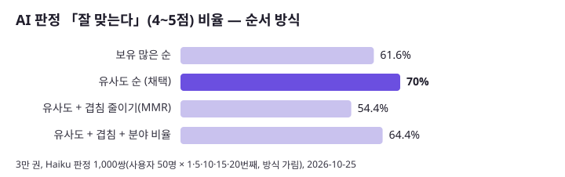

# 7. 책첵 추천 — 한 장 요약

- **이 문서가 답하는 것**: 남에게 보여 줄 때 「무엇을 만들었고, 무엇이 어려웠고, 어떻게 재서 무엇을 고쳤나」를 한 장으로. 숫자는 모두 [3-evaluation.md](3-evaluation.md)의 측정에서 가져옴(근거·조건은 거기).
- 공개용 페이지: https://claude.ai/artifact/HEoeTqicrZSPMh3qyVYmfp (원본 [`summary-page.html`](summary-page.html), 비공개 — 공유는 페이지의 Share에서). 그림: [`figures/`](figures/)(`python -X utf8 scripts/foryou/eval/make_charts.py`로 다시 그림).

## 한 줄
로그인 없이도 쓰는 전자도서관 검색 서비스에, **브라우저에 남은 본 책 몇 권과 책 내용 임베딩(KURE-v1)만으로** 개인 도서 추천을 붙이고, 사용자 기록이 없는 상태에서 **오프라인 시험과 방식을 가린 LLM 판정**으로 고칠 점을 숫자로 찾아 고친 기록.

## 무엇을 만들었나
- 브라우저: 본 책 점수(열기 1·10초 2·도서관 누름 3) → 기준 책 6권(분야당 2) — [1-how-it-works.md](1-how-it-works.md) 1절
- PC: 보유 많은 순 10만 권 중 소개 있는 책 + 추천목록 = 81,080권을 KURE-v1로 벡터화, 코사인 이웃 20권, 같은 작품 판정 규칙 — [2-data.md](2-data.md) 2~3절
- 서버(Spring Modulith `foryou` 모듈): 기준 책 이웃을 순위별로 번갈아 모으고 같은 작품·계획 밖 도서관 책을 빼 최대 60권 — 1-how-it-works.md 4절
- 화면: 사람마다 다른 분야 칩, 같은 저자 3연속 금지, 처음 온 사람은 분야를 돌려 가며, 가끔 안 본 분야 한 권 — 1-how-it-works.md 8~9절
- 자료: 해요체 요약 68,414권(Haiku), 표지 80,091권 — 2-data.md 4~5절

## 한눈에 보는 전후

| 무엇을 | 전 → 후 | 어디서 |
|---|---|---|
| 순서: 계획 도서관 수 순 → 유사도 순 (v1.15.1) | AI 판정 4~5점 **61.6 → 70.0%**, 흔한 책 **43.5 → 10.7%**, 맞힘 Hit@20 **16.8 → 31.8%** | E1·E2 |
| 다양성 장치(겹침 줄이기·분야 비율) | 넣지 않음: 판정 **54.4%**로 오히려 낮음 / 맞힘이 목록 책 치우침으로 부풀려짐 | E2 |
| 대상 3만 → 10만 권 | 판정 평균 **3.58 → 3.76**, 4~5점 **61.6 → 68.8%** | E3 |
| 같은 작품 규칙 강화 | 같은 작품이 섞인 쌍 **11 → 5 / 250**, 판정 그대로 | E4 |
| AI 검색과 이웃 표 범위 맞춤 | AI 검색이 쓸 수 있는 이웃 **9.47 → 19.82권** | E5 |
| 「다 대출 중」 막기: 문턱 3 (v1.20.2 운영, 2026-10-29) | 가입 가능 범위에서 바로 대출 **48 → 61%**, 1곳뿐 **11% → 0%**, 판정 손해 없음(3.78 → 3.86). 가중치 방식은 판정 −5.6%p라 안 씀 | E6·E7 |
| 요약 25,187권 해요체 | Haiku 하위 에이전트 26개 × 1,000권, 약 1시간 | 2-data.md 4절 |

## 어려웠던 점과 푼 방법
1. **사용자 기록이 없다** → 추천목록(KAIST·서울대·노벨 등)의 분야 묶음을 정답으로 한 맞힘 시험 + 가상 사용자 1,000명 + 방식을 가린 Haiku 판정. 판정은 실행마다 0.1~0.3점 흔들려 같은 실행 안에서만 비교
2. **지표가 틀릴 수 있다** → 맞힘 시험은 정답이 목록 책뿐이라 「분야 비율」(53.6%)과 「10만 권」(15.5%)에서 거꾸로 말함. 판정으로 다시 확인해 바로잡음(E2·E3)
3. **코드로 안 보이던 문제를 숫자로** → 운영은 새벽 점수가 꺼져 이웃을 비슷한 순이 아니라 도서관 수 순으로 늘어놓고 있었음(E1)
4. **벡터로 같은 작품을 못 가린다** → 같은 작품 쌍도 코사인 0.68~0.78로 보통 이웃과 같음 → 제목·저자 규칙(W2)
5. **두 기능이 한 표를 같이 씀** → 이웃 표를 넓히자 AI 검색이 쓸 수 있는 이웃이 반으로 줄어 범위를 맞춤(E5)
6. **원래 의도를 다시 살리기** → 「도서관 수 순」은 대출 중을 피하려던 것이었다는 사용자 설명을 듣고, 비슷함을 해치지 않는 문턱으로 되살림(E7)

## 배운 점
- 측정 조건을 잘못 잡으면 결론이 틀린다: 계획 도서관을 2,643곳 전부로 잡아 「기본 범위 91% 바로 대출」이라 했다가 실제 계획 규칙(377곳)으로 다시 재 약 48%로 바로잡음([4-history.md](4-history.md) 10절)
- 숫자가 좋아 보여도 치우침인지 다른 지표로 확인
- LLM 글 만들기는 하위 에이전트로 빠르게, 결과는 반드시 스크립트로 검사

## 한계
[3-evaluation.md](3-evaluation.md) 3절. 운영 사용량이 아직 적어(7일 방문 키 22개) 온라인 확인은 못 함.

## 다음
[5-improvements.md](5-improvements.md) — 문턱 3 적용(I-01, v1.20.2 운영), 머신러닝 보강(I-10~I-14, [6-ml-method.md](6-ml-method.md)), 기록·A/B(I-05·I-06).
