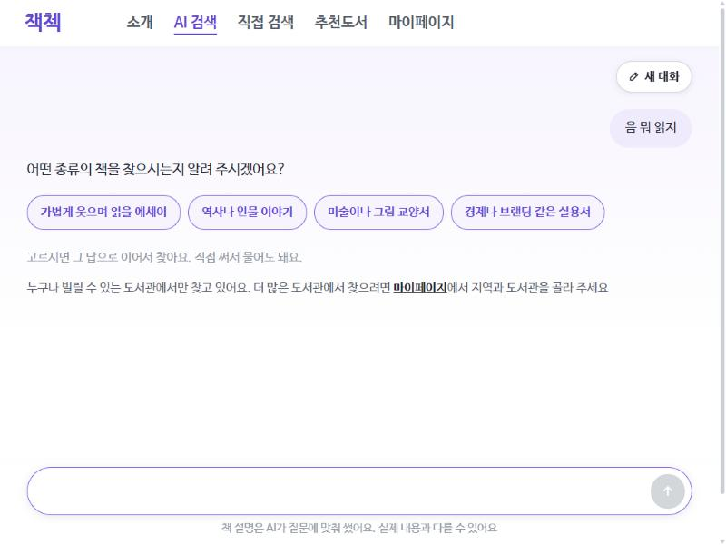
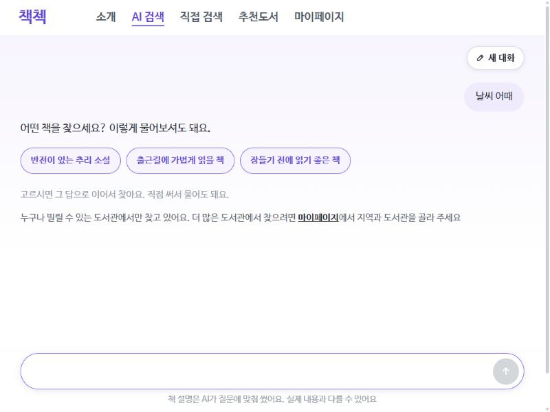

# AI 책 찾기 2차를 에이전트로: 만들고 재 보니 (2026-10-26)

책첵 「AI 책 찾기」의 2차 단계(후보 책 30권 중에서 고르고 소개 글을 쓰는 Haiku 호출)를, **도구를 쓰는 에이전트**로 바꿔 보았습니다. 에이전트는 바로 고를 수도 있고, 맞는 책이 없으면 다른 낱말로 한 번 더 찾을 수도 있고, 질문이 두 갈래로 읽히면 사용자에게 되물을 수도 있습니다. 만든 뒤 같은 질문 72개로 기존 방식과 나란히 재고 Sonnet이 카드마다 채점했습니다. 2026-10-26 사용자 결정 「AI 검색 계획 2·3단계」(2단계: 설정 뒤에 시제품, 3단계: 새 시험 세트로 전후 비교한 뒤에만 출시)입니다.

## 요약

- **운영 반영(v1.17.0, 2026-10-27)**: 에이전트의 도구 루프는 켜지 않고, 쓸모 있던 **되묻기만 한 번의 호출에** 넣고 **Haiku 생각 끄기 + 지시문 캐시**와 함께 켰습니다. 10만 권 위에서 두 번씩 잰 값: 맞음 78.0 → 80.6%, 애매한 질문 66.7 → 78.8%, 틀린 카드 1.32 → 1.02장, **첫 글 4.0 → 2.3초**, 분명한 질문 되묻기 0번. 대신 카드가 질문당 약 1장 줄어듭니다([11절](#11-운영에-넣은-조합-10만-권-위-최종-측정)).
- **운영 코드(v1.16.3) 위에서 두 번씩 돌린 평균은, 전체 맞음이 기존 77.0%, 에이전트 77.9%, 에이전트(3권 미만이면 다시 찾기) 80.1%입니다.** 같은 기존 방식을 두 번 돌려도 73.5%와 80.5%가 나와서, 이 차이는 흔들림 안입니다.
- 이득은 **앞 주제를 합치거나 애매하게 이어 묻는 질문**에 몰려 있습니다. 「앞 주제 둘 합치기」에서 질문당 맞는 카드가 2.7장에서 3.2장(에이전트), 4.2장(3권 미만 방식)으로 늘었습니다. 분명한 질문 15개에서는 되묻기가 **네 번 돌린 동안 한 번도 없었고** 점수도 같았습니다.
- 비용은 분명합니다. 에이전트는 답을 다 만든 뒤 한꺼번에 보내기 때문에, **첫 글이 보이기까지 5.1초에서 9.4~9.8초로 거의 두 배**가 됩니다. 검색 1,000번에 드는 돈은 $1.40에서 $1.85~1.96(+32~40%)입니다.
- 처음에는 v1.16.2 위에서 재서 에이전트가 70.5%에서 80.2~82.4%로 크게 이겼습니다. 그런데 같은 날 다른 세션이 기존 방식의 「앞 주제 합치기」를 고쳐 v1.16.3으로 내보냈고, 그 위에서 다시 재니 차이가 거의 사라졌습니다. **같은 문제를 더 싼 방법(한 번의 호출 + 규칙)이 먼저 풀었습니다.**
- **결정: 에이전트는 켜지 않고 설정 뒤에 둡니다**(`CHAEKCHECK_AISEARCH_PICK_MODE=single`이 기본). 다시 꺼낼 조건은 [8절](#8-결정과-다음)에 적었습니다.
- **그 대신 되묻기만 한 번의 호출에 넣었습니다**([10절](#10-되묻기만-한-번의-호출에)). 애매한 질문에서 맞음 69.4% → 77.8%, 맞는 카드 4.2 → 5.6장, 분명한 질문에서는 되묻기 0번이고, 첫 글은 그대로입니다(되묻지 않은 질문 5.1 → 5.4초).

## 1. 무엇을 바꿨나

| | 기존(single) | 에이전트(agent) |
|---|---|---|
| 2차 호출 | Haiku 한 번, JSON으로 고른 책과 글을 흘려 보냄(스트리밍) | Haiku에 도구 셋을 주고 최대 3턴 |
| 맞는 책이 없을 때 | 「찾지 못했어요」 | `search_again`: 모델이 고른 새 낱말 2~6개로 낱말 + 벡터 검색을 다시 해 새 후보를 줌(질문당 한 번) |
| 질문이 두 갈래일 때 | 한쪽으로 짐작해 고름 | `ask_user`: 되묻는 말과 고를 답 2~4개 → 화면에 버튼, 누르면 그 답으로 이어 찾음 |
| 실패하면 | — | 도구를 안 부르거나, 입력이 깨지거나, 턴을 다 쓰거나, 호출이 실패하면 기존 방식이 같은 후보로 답함 |

- 도구는 모두 `strict`이고 `tool_choice: auto`입니다(지금 모델에서 도구를 강제하면 400). 앞 턴의 답(thinking 블록 포함)은 그대로 다시 보냅니다.
- 모델에는 후보 책들의 분야 분포(「후보 분야: 문학(소설) 12권, …」)를 함께 줍니다. 질문과 분야가 크게 다르면 다시 찾기를 생각하라는 신호입니다.
- 다시 찾기 조건은 둘을 재 보았습니다. 사용자가 고른 **「맞는 책이 0권일 때만」**(agent)과, 비교용 **「3권보다 적을 때」**(agentfew)입니다(설정 `CHAEKCHECK_AISEARCH_PICK_SEARCH_AGAIN_WHEN`).
- SDK 없이 HTTP로 Messages API를 부르는 기존 클라이언트에 `converse`(도구 턴)를 더했습니다. 코드: `flow/AgentPicks`(도구 루프), `AiSearchFlow`의 `agentStep`·`searchAgain`, `llm/LlmClient.converse`, 웹 `AiChatPage`의 되묻기 버튼(사용자 시안 승인 뒤).

## 2. 재는 방법

**질문 72개를 다섯 묶음으로** 나눴습니다([`agent_questions.json`](../../scripts/aisearch/eval/agent_questions.json)):

| 묶음 | 수 | 예 | 보려는 것 |
|---|---|---|---|
| 애매한 질문(vague) | 20 | 「파이썬」, 「엄마」, 「로마」, 「llm」 | 되묻기가 도움이 되나 |
| 애매하게 이어 묻기(vague2) | 10 | 「ai agent나 인공지능 관련 책」 → 「llm인가」 | 앞 대화가 있을 때의 되묻기 |
| 앞 주제 둘 합치기(combine) | 15 | 「판타지 소설」 → 「추리 소설」 → 「위에 말한 두 개 섞은 느낌」 | 3턴 대화, 두 주제를 함께 다룬 책 |
| 책이 적은 주제(rare) | 12 | 「1990년대 한국 PC통신 문화」, 「양봉 입문서」 | 다시 찾기가 0장을 줄이나 |
| 분명한 질문(clear, 대조) | 15 | 「기후 위기를 다룬 책」(기존 평가 질문에서) | 쓸데없이 되묻거나 나빠지지 않나 |

- 질문마다 **사용자가 실제로 원한 책(want)** 을 적어 두었습니다(앱에는 보이지 않음). 예: 「엄마」 → 「엄마와 딸의 관계를 다룬 에세이」.
- 앱이 되물으면 **가상 사용자(Haiku)** 가 want에 가장 가까운 답을 고르고, 가까운 답이 없으면 want를 직접 칩니다. 그 답으로 나온 카드를 채점하고, 되묻는 한 턴의 시간·토큰도 그 질문에 더합니다.
- 채점은 Sonnet이 카드마다 want에 비춰 0~3점을 줍니다([채점 규칙](../../scripts/aisearch/eval/agent-JUDGE_RULES.md)). 두 주제를 합친 want에 한쪽만 다룬 책은 1점 이하입니다. 같은 (질문, 책)은 한 번만 채점해 모든 방식에 같은 점수를 씁니다.
- 로컬 PC 백엔드를 운영과 같은 설정으로 띄웠습니다(1차 ML, 이어 묻기 relation, 질문 벡터, 책 27,227권). 2차 Haiku는 실제 API입니다. 시간·토큰은 백엔드 로그 한 줄에서, 첫 글 시간은 스트림에서 첫 머리말·카드·되묻기가 온 때로 쟀습니다.
- **같은 방식을 두 번씩 돌려 평균**을 냈습니다. 기존 방식 두 번의 전체 맞음이 73.5% / 80.5%(v1.16.3), 70.5% / 74.6%(v1.16.2)라서 **5%p 안팎의 차이는 차이로 보지 않습니다.** 묶음이 10~20개라 묶음마다는 더 흔들립니다.

지표: **맞음** = 카드 중 2~3점 비율, **맞는 카드/질문** = 질문 하나에 2점 이상 카드 수, **틀린 카드/질문** = 0~1점 카드 수, **0장** = 카드 없이 끝난 질문 수(72개 중).

## 3. 결과: 운영 코드(v1.16.3) 위에서, 두 번 평균

| 방식 | 맞음 | 맞는 카드/질문 | 틀린 카드/질문 | 0장 | 되묻기 | 다시 찾기 | 시간 평균 / 느린 10% | 첫 글 | 입력 / 출력 토큰 | 검색 1,000번 |
|---|---|---|---|---|---|---|---|---|---|---|
| 기존(single) | 77.0% | 4.0 | 1.19 | 9.5 | 0 | 0 | 7.2 / 10.1초 | **5.1초** | 8,160 / 1,176 | **$1.40** |
| 에이전트(0권일 때만) | 77.9% | 4.4 | 1.24 | 7.5 | 5.5 | 5.5 | 9.1 / 12.0초 | 9.4초 | 10,748 / 1,557 | $1.85 |
| 에이전트(3권 미만) | **80.1%** | **4.6** | **1.15** | 9.0 | 4.5 | 13.0 | 9.4 / 12.5초 | 9.8초 | 11,563 / 1,609 | $1.96 |

돈은 설정의 Haiku 값(입력 100만 토큰 $0.10, 출력 $0.50)으로 셈했습니다. 기존 방식 $1.40은 앞선 기록([1차 ML 결정 기록](ai-search-ml-first-call-decisions-2026-10-26.md))의 $1.40과 같습니다.

**묶음마다** (맞음 / 맞는 카드·질문 / 0장):

| 묶음 | 기존 | 에이전트(0권) | 에이전트(3권 미만) |
|---|---|---|---|
| 애매한 질문 (20) | 69.4% / 4.2 / 2.5 | 70.0% / 4.6 / 2.5 | 68.3% / 4.5 / 3.0 |
| 애매하게 이어 묻기 (10) | 75.9% / 4.4 / 1.0 | 75.7% / 5.2 / 0 | **85.9% / 5.5** / 0.5 |
| 앞 주제 둘 합치기 (15) | 60.3% / 2.7 / 0.5 | 67.4% / 3.2 / 0.5 | **75.3% / 4.2** / 0 |
| 책이 적은 주제 (12) | 74.2% / 1.0 / 5.0 | 67.6% / 1.0 / 4.5 | 57.5% / 1.0 / 5.5 |
| 분명한 질문 (15) | 96.8% / 7.0 / 0.5 | 96.5% / 7.3 / 0 | 97.4% / 7.6 / 0 |

읽는 법:

- **합치기·이어 묻기**: 「3권 미만이면 다시 찾기」가 합치기에서 맞는 카드를 1.5장 늘렸습니다. 두 주제를 다 다룬 책은 처음 후보 30권에 적게 들어오는데, 모델이 두 주제를 함께 담은 낱말로 다시 찾기 때문입니다(4절 사례).
- **애매한 질문**: 되묻기는 20개 중 1~3개에서만 일어나 묶음 점수를 거의 바꾸지 못했습니다. 모델은 「llm」, 「로마」, 「그림」처럼 뜻이 정말 갈리는 말에서만 되묻고, 「파이썬」, 「고양이」에는 흔한 뜻으로 바로 답했습니다.
- **책이 적은 주제**: 다시 찾아도 맞는 카드는 1.0장 그대로였습니다. 「양봉」, 「우표 수집」, 「조향」은 27,227권 안에 맞는 책이 없어서 다시 찾아도 0장이고, 이것은 지어내지 않고 「없음」을 확인한 결과입니다. 대신 약한 카드가 섞여 맞음 비율은 내려갑니다.
- **분명한 질문**: 네 번 돌린 동안 되묻기 0번이고, 점수는 흔들림 안에서 같습니다. 에이전트가 보통 질문을 망치지는 않습니다.

## 4. 사례

| 질문 | 에이전트가 한 일 | 결과 |
|---|---|---|
| 「ai agent나 인공지능 관련 책」 → 「llm인가」 | 되물음: 「LLM의 원리를 다룬 책 / LLM으로 서비스를 만드는 개발서 / 프롬프트 작성법」 | v1.16.3 위 네 번 중 세 번 되물음. 가상 사용자가 「원리」를 골라 LLM 책 3~8장 |
| 「엄마」 | 되물음: 「육아 / 모녀 관계 / 엄마를 그리워하는 글 / 그림책」 | v1.16.2 위에서 두 방식 모두. 「모녀 관계」로 8장 |
| 「요리 에세이」 → 「여행 에세이」 → 「둘 다 있는 책」 | 3권 미만 → 다시 찾기 | 기존 4장 → 8장(『여행자의 밥』, 『진짜 스페인은 시골에 있다』 등) |
| 「클래식 음악 책」 → 「수학 책」 → 「두 개 엮은 책」 | 되물음 → 다시 찾기 | 한 번은 『수학이 사랑한 음악』 1장, 한 번은 6장 중 클래식 입문서가 섞임. v1.16.2에서는 앞 대화를 놓치고 「두 사람의 편지를 엮은 책?」이라고 엉뚱하게 되물음 |
| 「1990년대 한국 PC통신 문화를 다룬 책」 | 다시 찾기 | 기존 0장 → 『디지털 세상이 진화하는 방식』 1장(네 번 중 세 번) |
| 「바둑 입문서」 | 다시 찾기 | v1.16.2에서 한 번 『야구X수학』을 냄(틀린 카드). v1.16.3에서는 0장 |
| 「식물 책」 → 「그림 그리기 책」 → 「합쳐서」 | 다시 찾기 | 기존 7장 → 1장(『누구나 쉽게 따라하는 꽃 그리기』). 다시 찾은 목록이 처음보다 좁아 오히려 줄어듦 |

## 5. 처음 잰 결과(v1.16.2 위)와 다시 잰 까닭

처음에는 그때 운영 코드 v1.16.2 위에서 쟀습니다(기존 두 번, 에이전트 한 번씩).

| 방식 | 맞음 | 맞는 카드/질문 | 틀린 카드/질문 | 0장 | 합치기 맞음 / 맞는 카드 |
|---|---|---|---|---|---|
| 기존(v1.16.2, 두 번 평균) | 72.5% | 3.8 | 1.42 | 14.5 | 50.0% / 1.5 |
| 에이전트(0권) | 80.2% | 4.7 | 1.15 | 5.0 | 74.6% / 3.3 |
| 에이전트(3권 미만) | 82.4% | 4.9 | 1.04 | 5.0 | **96.1% / 4.9** |

이때는 에이전트가 8~10%p 이겼고, 합치기는 두 배 넘게 좋아졌습니다. 그런데 같은 날 평가 세션이 기존 방식에 「앞 질문들을 합치는 말(「두 개」, 「둘 다」, 「섞은」)이 오면 앞 질문들을 이어 붙여 다시 찾기」 규칙과 지시문 네 줄을 더했고, 사용자 승인으로 **v1.16.3**으로 내보냈습니다. 그래서 에이전트 브랜치를 v1.16.3 위로 올려(rebase) 세 방식을 두 번씩 다시 쟀습니다(3절).

| 기존 방식 | 맞음 | 0장 | 합치기 맞음 / 맞는 카드 / 0장 |
|---|---|---|---|
| v1.16.2 (두 번 평균) | 72.5% | 14.5 | 50.0% / 1.5 / 4.0 |
| v1.16.3 (두 번 평균) | **77.0%** | **9.5** | **60.3% / 2.7 / 0.5** |

v1.16.3이 기존 방식의 가장 약한 곳을 메워, 에이전트와의 차이 대부분이 사라졌습니다. 에이전트 쪽에서도 같은 변화가 보입니다. v1.16.2 위에서는 합치기 15개 중 4~6개에서 「위에 말한 두 개가 무엇인지」를 되물었는데, 앞 질문들이 함께 들어가는 v1.16.3 위에서는 1~2개로 줄었습니다. **에이전트의 이득으로 보였던 것의 상당 부분은 「앞 질문을 함께 찾는다」는 것 자체였고, 그것은 호출 한 번 안에서 규칙으로도 할 수 있었습니다.** 기준선이 바뀌면 다시 재야 한다는 것, 그리고 처음 결과만으로 내보냈다면 비용만 늘었을 것이라는 점이 이번 실험의 가장 큰 배움입니다.

## 6. 드는 것

- **첫 글까지의 시간**: 기존 방식은 고르는 동안 머리말과 카드를 흘려 보내 5.1초면 첫 글이 보입니다. 에이전트는 `answer` 도구 입력이 다 만들어진 뒤에야 보낼 수 있어 9.4~9.8초입니다. 체감 속도로는 가장 큰 손해입니다.
- **전체 시간**: 평균 +1.9~2.2초, 느린 10%는 10.1초에서 12.0~12.5초.
- **토큰과 돈**: 입력 +32~42%(도구 설명, 다시 찾은 후보 목록), 출력 +32~37%. 검색 1,000번에 $1.40 → $1.85~1.96.
- **실패**: 에이전트로 보낸 요청 713번(v1.16.3 위 468번, v1.16.2 위 245번, 되묻기 뒤 턴 포함)에서 기존 방식으로 넘어간 일은 0번이었습니다(미리 한 번 데운 서버 기준. 막 띄운 서버의 첫 요청은 15초 제한을 넘긴 적이 있음).

## 7. 한계

- 질문 72개, 한 사람이 만든 질문과 want. 묶음마다 10~20개라 묶음 숫자는 크게 흔들립니다(같은 기존 방식이 합치기에서 56.3% / 64.6%).
- 분명하다고 보고 넣은 이어 묻기의 첫 질문 「그림책」에서도 두 번 되물었습니다(「어떤 주제의 그림책?」). 쓸데없는 되묻기가 0은 아닙니다.
- 채점은 사람이 아니라 Sonnet입니다. 같은 채점표를 모든 방식에 썼습니다.
- 되묻기의 값은 카드 점수로 다 잡히지 않습니다. 가상 사용자는 늘 want를 알고 답하지만, 실제 사용자는 되묻기를 귀찮아할 수도 있고 오히려 고마워할 수도 있습니다. 화면에서 사람이 써 본 결과는 없습니다.
- 시간은 로컬 PC 백엔드와 실제 Haiku API로 쟀습니다. 운영 서버(ARM 2코어)에서는 다를 수 있습니다.
- 에이전트는 한 번만 다듬었습니다(다시 찾기 조건 두 가지). 지시문을 더 다듬으면 달라질 수 있습니다.

## 8. 결정과 다음

**에이전트는 켜지 않습니다.** 설정 뒤에 두고(`single` 기본), 코드와 웹 되묻기 화면은 브랜치 `claude/aisearch-agent`에 남깁니다. 지금 숫자로는 전체 정확도가 흔들림 안에서 같고, 첫 글이 두 배 늦어지며, 돈은 3분의 1 넘게 더 듭니다.

다시 꺼낸다면 이 순서입니다:

1. **첫 글 시간 줄이기**: `answer` 도구의 입력을 흘려 받아(eager input streaming) 머리말과 카드를 만들어지는 대로 보내기. 첫 글이 기존과 비슷해지면 가장 큰 손해가 사라집니다.
2. **이어 묻는 질문에만 켜기**: 이득은 이어 묻기·합치기(턴 2 이상)에 몰려 있고, 첫 질문에서는 거의 없습니다. 턴 2부터만 에이전트로 하면 비용 증가가 줄어듭니다.
3. **다시 찾기는 「3권 미만」**: 합치기에서 더 좋았고(맞는 카드 3.2 → 4.2), 분명한 질문은 나빠지지 않았습니다. 다만 책이 적은 주제에서는 약한 카드가 섞이므로, 다시 찾은 뒤에도 fit 2 이상만 남기는 규칙을 더 지켜야 합니다.
4. 위를 바꾼 뒤 이 시험을 그대로 두 번 다시 돌려 기존 방식과 비교합니다.

## 9. 다시 돌리는 법

도구는 [`scripts/aisearch/eval/`](../../scripts/aisearch/eval/)에 있습니다. 결과 파일(카드, 채점)은 git 밖 `data/aisearch-eval-2026-10-25/agent/`에 둡니다.

1. 로컬 백엔드를 운영과 같은 설정으로 띄웁니다: `CHAEKCHECK_AISEARCH_FIRST_CALL=ml`, 질문 벡터 local, 모델 폴더 `chaekcheck-data\ml\aisearch-model-e2e`(1차·이어 묻기 모델 포함), `CHAEKCHECK_AISEARCH_PICK_MODE=single|agent`, `CHAEKCHECK_AISEARCH_PICK_SEARCH_AGAIN_WHEN=none-fit|few-fit`, 하루 예산은 `CHAEKCHECK_AISEARCH_BUDGET_DAILYUSD`로 넉넉히(같은 DB를 쓰는 다른 측정과 하루 예산 $2를 나눠 씀).
2. 질문 두 개로 서버를 데운 뒤 `python agent_run.py <이름> <백엔드 로그 경로> [포트]` → `run-<이름>.json`. 한 번에 질문 72개, 약 15~20분, 약 $0.15.
3. `python agent_judge.py prep` → `jd/in-NN.json`(30개씩). Sonnet 하위 에이전트에게 `agent-JUDGE_RULES.md`대로 `out-NN.json`을 쓰게 합니다. 이미 채점한 (질문, 책)은 다시 내지 않습니다.
4. `python agent_judge.py score`(돌린 것마다), `python agent_judge.py avg`(같은 방식의 `<이름>`과 `<이름>-r2` 평균, 이 보고서의 표).

## 10. 되묻기만 한 번의 호출에

에이전트 시험에서 되묻기는 되물은 질문의 맞는 카드를 1.5장에서 3.9장으로 늘렸고, 다시 찾기는 쓸모가 거의 없었습니다. 비용은 대부분 도구 루프에서 나왔습니다. 그래서 사용자 결정(2026-10-26 「이렇게 하자」)으로 **되묻기만 기존 한 번의 스트리밍 호출에 넣었습니다**.

- 고르기 JSON 맨 앞에 `ask` 칸(`question`, `choices`)을 둡니다. 맨 앞이라 머리말을 흘려 보내기 전에 되물을지 압니다. 되물을 때는 머리말과 카드를 보내지 않고 `ask` 이벤트만 보냅니다(웹의 되묻기 버튼은 에이전트 때 만든 것 그대로).
- 지시문 두 줄: 뜻이 여럿으로 읽혀 고를 책이 크게 달라질 때(「그림」, 「llm인가」, 「아니 그런 거 말고」, 「음...」)만 되묻고, 흔한 뜻이 분명하거나 조건 몇 가지가 빠졌을 뿐이면 되묻지 않습니다.
- 1차가 「책 찾기 아님」으로 끝나는 질문(「날씨 어때」)에는 AI 호출 없이 고정 되묻기 「어떤 책을 찾으세요? 이렇게 물어보셔도 돼요.」와 예시 질문 3개를 보냅니다. 지금 운영은 「맞는 책을 찾지 못했어요」입니다(사용자 「음... 이런거에 대응가능한거지?」).
- 설정 `CHAEKCHECK_AISEARCH_PICK_ASK_BACK`(기본 `false`). 꺼져 있으면 지시문과 JSON 형식이 전과 같습니다.

같은 72문항을 두 번 돌린 평균(v1.16.3 위):

| 방식 | 맞음 | 맞는 카드/질문 | 틀린 카드/질문 | 0장 | 되묻기 | 첫 글 | 입력 / 출력 토큰 | 검색 1,000번 |
|---|---|---|---|---|---|---|---|---|
| 기존 | 77.0% | 4.0 | 1.19 | 9.5 | 0 | 5.1초 | 8,160 / 1,176 | $1.40 |
| **기존 + 되묻기** | 79.6% | 4.5 | 1.15 | 7.0 | 11 | 6.1초 | 10,172 / 1,347 | $1.69 |
| 에이전트(0권) | 77.9% | 4.4 | 1.24 | 7.5 | 5.5 | 9.4초 | 10,748 / 1,557 | $1.85 |

| 묶음 | 기존 | 기존 + 되묻기 | 에이전트(0권) |
|---|---|---|---|
| 애매한 질문 (20) | 69.4% / 4.2장 / 0장 2.5 | **77.8% / 5.6장 / 0장 0.5** | 70.0% / 4.6장 / 0장 2.5 |
| 애매하게 이어 묻기 (10) | 75.9% / 4.4장 | 80.3% / 4.9장 | 75.7% / 5.2장 |
| 앞 주제 둘 합치기 (15) | 60.3% / 2.7장 | 60.0% / 3.0장 | 67.4% / 3.2장 |
| 책이 적은 주제 (12) | 74.2% / 1.0장 | 69.4% / 1.0장 | 67.6% / 1.0장 |
| 분명한 질문 (15) | 96.8% / 7.0장, 되묻기 0 | 96.8% / 7.1장, **되묻기 0** | 96.5% / 7.3장, 되묻기 0 |

- **애매한 질문에서 확실히 나아졌습니다**(+8.4%p, 맞는 카드 +1.4장, 0장 2.5 → 0.5). 에이전트보다 자주 되묻습니다(20개 중 7~8개: 「그림」, 「로마」, 「커피」, 「공부」, 「전쟁」, 「사랑」, 「llm」). 되물을 말과 고를 답은 에이전트 때와 거의 같습니다.
- **첫 글**: 되묻지 않은 질문은 거의 그대로(분명한 질문 5.1 → 5.4초). 되물은 질문은 되묻는 말이 3~5초에 뜨고, 「책 찾기 아님」의 고정 되묻기는 1초 안에 뜹니다. 표의 6.1초는 되물은 질문의 두 턴을 더한 값입니다.
- **비용**: 되묻지 않은 질문은 지시문이 길어진 만큼 +3%(분명한 질문 $1.55 → $1.60). 전체 +21%는 되물은 질문이 버튼을 누른 뒤 한 번 더 찾는 몫입니다.
- **잘못 되물은 것**: 합치기 3턴 「둘이 합쳐진 거」(미술사 → 소설)에 「미술사와 심리학?」처럼 앞 질문 하나를 놓친 되묻기 2번, 「양봉 입문서」에 「주식 차트의 양봉인지」 1번.
- **1차가 잘못 나눈 것**: 「엄마」, 「AI」는 1차 ML이 「책 찾기 아님」으로 나눠 고정 되묻기(상관없는 예시 버튼)가 나왔습니다. 지금 운영에서는 같은 질문이 「찾지 못했어요」로 끝나므로 나빠진 것은 아니지만, 한 낱말 주제를 「책 찾기 아님」으로 보내는 1차 모델의 문제가 드러났습니다.

화면(로컬, 실제 Haiku): 왼쪽 「음 뭐 읽지」 → Haiku의 되묻기, 오른쪽 「날씨 어때」 → 고정 되묻기.

 

**판단**: 되묻기만 넣은 한 번의 호출이, 애매한 질문에서는 에이전트보다 낫고, 보통 질문의 속도와 비용은 지키고, 분명한 질문은 망치지 않습니다. 내보내기 전에 고칠 것은 둘입니다. (1) 지시문에 「앞 질문들의 주제를 가리키는 합치기 말에는 되묻지 않는다」 한 줄, (2) 1차가 한 낱말 주제를 「책 찾기 아님」으로 보내지 않게 하기(또는 그런 질문에는 고정 되묻기 대신 2차로 보내기).

## 11. 운영에 넣은 조합: 10만 권 위 최종 측정

10절 뒤에 바뀐 것: 운영 AI 검색이 10만 권(76,759권)이 되었고, 되묻기의 두 가지 고침(합치기 말에는 되묻지 않기 — 지시문과 코드 둘 다, 한 낱말 「책 찾기 아님」은 2차로)을 넣었고, 응답 시간을 단계별로 재 보니 대부분이 **Haiku가 첫 글자를 보내기까지**(생각하는 시간)라서 생각 끄기와 지시문 캐시를 더했습니다.

**단계별 시간**(질문 11개 중간값, 10만 권): 질문 벡터 48ms · 1차 ML 6ms · 책 벡터 비교 224ms(27k 때 84ms) · 낱말 검색 99ms · 섞기·카드 정보 20ms → 여기까지 약 0.45초. 그 뒤 Haiku 첫 글자까지 생각 켬 2.0~4.1초(질문마다 0.8~5.7초), 생각 끔 1.2초(1.0~2.3초), 생각 끔+캐시 1.1초(1.0~1.6초).

**72문항, 두 번 평균**:

| 방식 | 맞음 | 맞는 카드/질문 | 틀린 카드/질문 | 애매한 질문 맞음 | 분명한 질문 되묻기 | 첫 글 | 전체 | 출력 토큰 |
|---|---|---|---|---|---|---|---|---|
| 생각 켬(v1.16.3 운영) | 78.0% | 4.7 | 1.32 | 66.7% | — | 4.0초 | 6.5초 | 1,158 |
| 생각 끔 + 캐시 | 76.1% | 3.9 | 1.22 | 66.0% | — | 1.9초 | 4.1초 | 617 |
| **되묻기 + 생각 끔 + 캐시 (v1.17.0)** | **80.6%** | 4.2 | **1.02** | **78.8%** | **0번** | **2.3초** | 4.5초 | 633 |

**기존 57문항, 종류별, 두 번 평균** (사용자 「생각을 끄면 부정어/조건 등이 안 될까봐」):

| 종류 | 생각 켬: 맞음 / 맞는 카드 / 틀린 카드 | 생각 끔: 맞음 / 맞는 카드 / 틀린 카드 |
|---|---|---|
| 부정어 (5) | 93.8% / 7.5 / 0.50 | 97.4% / 7.5 / 0.20 |
| 조건 (4) | 100% / 7.9 / 0.00 | 98.2% / 6.9 / 0.12 |
| 두 주제 (4) | 96.7% / 7.2 / 0.25 | 98.1% / 6.6 / 0.12 |
| 비슷한 책 (9) | 95.9% / 6.6 / 0.28 | 95.7% / 4.9 / 0.22 |
| 뜻 맞추기 (7) | 94.9% / 6.6 / 0.36 | 91.1% / 5.9 / 0.57 |
| 그 밖 (28) | 88.3% / 6.4 / 0.84 | 88.4% / 5.6 / 0.73 |
| 전체 | 92.3% / 6.7 / 0.56 | 92.1% / 5.8 / 0.50 |

첫 글 중간 4.4 → 1.7초(느린 10% 6.3 → 2.3초), 전체 7.5 → 4.3초, 출력 토큰 1,404 → 665.

- **생각을 꺼도 부정어·조건은 무너지지 않습니다.** 「소설 말고」, 「수식 없이」, 「번역서 말고 한국 작가」, 「잔인하지 않은」 모두 걸러야 할 책을 걸렀고, 부정어는 틀린 카드가 오히려 줄었습니다.
- **대신 카드가 줄어듭니다**(질문당 6.7 → 5.8장, 「○○ 같은 책」 6.6 → 4.9장). 생각 없이 고르면 덜 확실한 책을 빼는 쪽으로 기울어 맞는 책 일부도 빠집니다.
- **결정(사용자 2026-10-26 「되묻기 + 생각 끄기 + 캐시로 배포해줘」)**: 첫 글 2초 안팎, 애매한 질문 +12%p, 틀린 카드 감소, 출력 토큰 절반을 얻고, 카드 수 감소는 받아들임. 카드 수를 지시문으로 되살리는 것은 다음 일로.
- 표 원본: [`ai-search-eval/ask-back-final-2026-10-26.md`](ai-search-eval/ask-back-final-2026-10-26.md). 도구: `agent_run.py`(`AGENT_QS`로 57문항), `agent_judge.py`, `agent57_types.py`.

