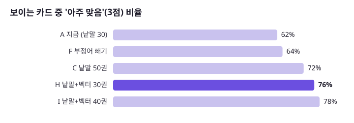
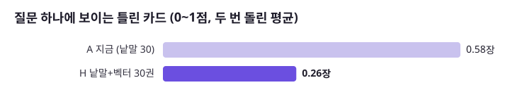
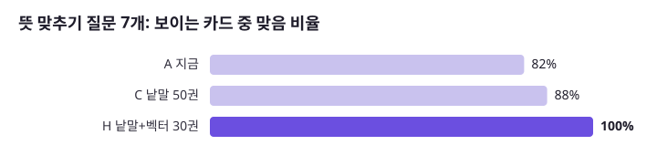
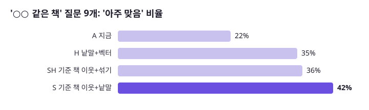

# AI 책 찾기 강화 실험: 무엇이 얼마나 나아지나 (2026-10-25)

책첵의 「AI 책 찾기」를 강화할 방법 7가지를 **같은 질문 50개(+비슷한 책 질문 7개)로 재현해 숫자로 비교**했습니다. 운영 코드와 같은 규칙으로 후보를 뽑고, 운영과 같은 지시문으로 AI가 고르게 한 뒤, 사용자에게 보일 카드를 별도의 심사 모델이 0~3점으로 채점했습니다.

## 한눈에

| 바꾼 것 | 숫자로 본 효과 | 비용 | 판단 |
|---|---|---|---|
| **낱말 검색 + 벡터 검색 섞기 (후보 30권 그대로)** | 「아주 맞는 카드」 **62% → 76%**, 틀린 카드 **0.58 → 0.26장/질문 (−55%)**, 뜻으로 묻는 질문 맞음 **82% → 100%** | 2차 입력 그대로. 질문 벡터 1회(서버 int8 기준 중간 106ms) | **넣을 것** |
| **「○○ 같은 책」은 그 책의 이웃 책을 후보로** | 「아주 맞음」 **22% → 42%**, 맞음 71% → 79% (질문 9개) | 그대로 (이웃은 이미 계산돼 있음) | **넣을 것** |
| 후보를 30권 → 50권 | 「아주 맞음」 62% → 72% | 2차 입력 **+66%** | 섞기가 더 싸고 더 좋음 |
| 2차 지시문 고침 (조건이 분명히 다르면 1점, 8권 억지로 안 채움) | 「아주 맞음」 +2~4%p, 틀린 카드 변화 없음, 답 없음 1건 생김 | 그대로 | 흔들림 안 → 보류 |
| 부정어 「뺄 말」 따로 뽑기 | 변화 없음. **지금도 빼 달라는 책이 카드에 나온 적 0~1건** | 그대로 | 필요 없음 |
| 이웃 책 10권 더하기 (모든 질문) | 맞는 후보 +4.5권 (같은 10칸을 낱말 후보로 채우면 +5.9권) | 2차 입력 +33% | 낱말 후보보다 못함 |
| 같은 제목 한 권만 | 변화 없음 (중복 드묾) | — | 필요 없음 |



## 1. 지금 AI 책 찾기는 어떻게 도나

```
질문 ─ 1차 AI(Haiku): 검색어 1~8개 + 핵심어 1~4개
     ─ 낱말 맞추기(PostgreSQL pg_bigm): 3만 939권에서 내 도서관이 가진 책 중 핵심어·검색어가 많이 든 30권
     ─ 2차 AI(Haiku): 30권의 제목·저자·한 줄 소개를 보고 0~8권을 고르고 적합도 0~3을 매김 → 2 이상만 카드로
```

약한 곳으로 보였던 것: 낱말이 겹치지 않으면 못 찾음(「번아웃」 질문에 소개에는 「지침」만 있는 책), 「소설 말고」 같은 부정어, 「아몬드 같은 소설」처럼 다른 책을 기준으로 묻는 질문.

## 2. 재는 방법

### 평가 질문 57개

| 유형 | 수 | 예 |
|---|---|---|
| 기존 비교 질문 | 28 | 다이어트 식단을 자세히 다룬 책, 한국 SF 단편집 |
| 부정어 | 5 | 소설 말고 위로가 되는 책, 번역서 말고 한국 작가가 쓴 경제 책 |
| 뜻 맞추기 | 7 | 번아웃이 왔을 때 읽을 책, 성인 ADHD를 이해하는 책 |
| 두 주제 | 4 | 역사와 과학을 함께 다룬 책 |
| 조건 | 4 | 일본 추리소설, 청소년을 위한 진로 책 |
| 비슷한 책 | 9 | 채식주의자 같은 소설, 아몬드 같은 성장 소설, 데미안 같은 고전 소설 |

질문 목록: [`scripts/aisearch/eval/eval_questions.json`](../../scripts/aisearch/eval/eval_questions.json). 질문 1~50으로 주 비교를, 비슷한 책 9개로 따로 비교했습니다.

### 재현한 것

1. **1차 호출**: 운영 `Prompts.KEYWORD_SYSTEM` 그대로 Haiku가 질문마다 검색어·핵심어를 뽑아 **고정**했습니다. 모든 변형이 같은 검색어를 씁니다.
2. **후보 뽑기**: 로컬 DB의 `aisearch.search_book`(운영과 같은 30,939권, 한 줄 27,098권)에서 운영 `CandidateQuery`와 같은 규칙(NFKC·소문자·공백 제거, 핵심어 먼저, 맞은 낱말 수, 내 도서관 수, 책 번호 순)으로 뽑았습니다. 내 도서관은 마포구 거주(지역 1114)로 가입할 수 있는 65곳입니다(웹과 같은 scope `joinable`).
3. **벡터**: 책 벡터는 사이클 23에서 만든 KURE-v1(1024차원, 제목·저자·출판사·연도 + 소개 앞 300자) 30,907권, 질문 벡터는 같은 모델로 만들었습니다. 섞기는 RRF(k=60)로 낱말 50위·벡터 60위를 합쳐 30권을 둡니다.
4. **2차 호출**: 운영 `Prompts.PICK_SYSTEM` 그대로, 운영과 같은 모양의 메시지(`질문: … 고를 수 있는 책: 1. 제목: … / 저자: … / 한 줄: …`)로 Haiku가 고르고, 운영 `AiSearchFlow`처럼 번호 확인 → 적합도 2 이상 → 8장까지를 카드로 셉니다.
5. **채점**: 후보로 나온 책 **4,870쌍(질문×책)**을 Sonnet이 운영 적합도와 같은 기준으로 0~3점을 매겼습니다. 빼 달라고 한 책, 나라·장르가 분명히 다른 책은 0점. 모든 변형이 같은 채점표를 씁니다(새 변형은 새로 나온 책만 채점).

### 지표

| 지표 | 뜻 |
|---|---|
| 맞음% | 보이는 카드 중 2점 이상(중심 주제가 맞음) |
| **아주 맞음%** | 보이는 카드 중 3점(주제와 조건이 다 맞음) — 차이가 가장 잘 드러남 |
| 틀린 카드 | 질문 하나에 보이는 0~1점 카드 수 |
| 전부 맞은 질문 | 보이는 카드가 모두 2점 이상인 질문 수 |
| 2차 입력 글자 | 2차 호출에 넣는 후보 글자 수(비용 대용) |
| 맞는 후보 | 후보 30~50권 중 2점 이상 (2차 AI가 고를 수 있는 재료) |

## 3. 결과

### 3-1. 사용자에게 보이는 카드 (질문 50개)

| 변형 | 카드/질문 | 맞음% | 아주 맞음% | 틀린 카드 | 전부 맞은 질문 | 답 없음 | 2차 입력 글자 |
|---|---|---|---|---|---|---|---|
| A 지금 (낱말 30) — 1회 | 8.0 | 94 | 62 | 0.48 | 38 | 0 | 4,292 |
| A 지금 — 2회 | 8.0 | 92 | 62 | 0.68 | 34 | 0 | 4,292 |
| C 낱말 50권 | 7.8 | 95 | 72 | 0.36 | 40 | 1 | 7,146 |
| F 부정어 빼기 | 8.0 | 94 | 64 | 0.48 | 38 | 0 | 4,292 |
| **H 낱말+벡터 30권 — 1회** | 8.0 | 96 | **76** | **0.28** | 43 | 0 | 4,243 |
| **H 낱말+벡터 30권 — 2회** | 8.0 | 97 | **75** | **0.24** | 46 | 0 | 4,243 |
| I 낱말+벡터 40권 | 8.0 | 96 | 78 | 0.30 | 42 | 0 | 5,630 |



유형별 맞는 카드 / 맞음% (1회):

| 변형 | 기존(28) | 부정어(5) | 뜻 맞추기(7) | 두 주제(4) | 조건(4) |
|---|---|---|---|---|---|
| A 지금 | 7.7 / 96% | 8.0 / 100% | 6.6 / **82%** | 8.0 / 100% | 7.8 / 97% |
| C 낱말 50권 | 7.6 / 99% | 8.0 / 100% | 7.0 / 88% | 8.0 / 100% | 7.5 / 94% |
| H 낱말+벡터 30권 | 7.9 / 99% | 7.6 / 95% | 8.0 / **100%** | 7.8 / 97% | 8.0 / 100% |



**읽는 법**: 「맞음」은 이미 94%라 거의 차이가 없습니다. 차이는 「딱 맞는 책이냐」(3점)와 「엉뚱한 카드가 몇 장 섞이냐」에서 납니다. 섞기(H)는 같은 30칸, 같은 2차 비용으로 두 번 돌려도 75~76%·0.24~0.28장으로 지금(62%·0.48~0.68장)보다 확실히 낫습니다.

### 3-2. 후보 단계 (2차 AI가 고를 재료, 질문 50개)

| 변형 | 후보 수 | 맞는 후보 | 아주 맞는 후보 | 정밀도 | 앞 8권 중 맞음 |
|---|---|---|---|---|---|
| A 지금 (낱말 30) | 30 | 20.3 | 9.7 | 68% | 6.0 |
| B 낱말 40 | 40 | 26.2 | 12.0 | 66% | 6.0 |
| C 낱말 50 | 50 | 32.0 | 14.8 | 64% | 6.0 |
| D 같은 제목 한 권만 | 30 | 20.2 | 9.5 | 67% | 5.9 |
| E 낱말 30 + 이웃 10 | 40 | 24.8 | 11.9 | 62% | 6.0 |
| F 부정어 빼기 | 30 | 20.1 | 10.0 | 67% | 5.8 |
| G 벡터만 | 30 | 17.0 | 10.3 | 57% | 5.4 |
| H 낱말+벡터 30 | 30 | 20.2 | 11.2 | 67% | 6.3 |
| I 낱말+벡터 40 | 40 | 25.4 | 13.5 | 63% | 6.3 |

- 지금도 50개 중 48개 질문은 후보 30권 안에 맞는 책이 8권 넘게 있습니다 → 병목은 「책이 있느냐」가 아니라 「얼마나 딱 맞는 책이 후보에 들어오느냐」.
- **벡터만으로는 낱말보다 못합니다**(맞는 후보 17.0 vs 20.3). 「한국 SF」에 중국 소설 「삼체」가 1위로 오는 식으로 나라·장르 조건을 놓칩니다. 섞어야 둘의 장점이 합쳐집니다.

### 3-3. 「○○ 같은 책」 질문 (9개)

| 변형 | 맞음% | 아주 맞음% | 틀린 카드 | 전부 맞은 질문 |
|---|---|---|---|---|
| A 지금 | 71 | 22 | 2.33 | 1 |
| H 낱말+벡터 | 74 | 35 | 1.89 | 3 |
| **S 기준 책 이웃 + 낱말** | **79** | **42** | **1.67** | 2 |
| SH 기준 책 이웃 + 섞기 | 78 | 36 | 1.78 | 4 |

S: 질문에서 책 제목을 찾고(검색 책 제목을 글자만 남겨 질문에 들어 있는 가장 긴 것), 그 책의 KURE 이웃 20권을 먼저, 나머지를 낱말 후보로 채웁니다. 예: 「데미안 같은 고전 소설」 → 지금은 「첫사랑」·「앵무새 죽이기」, S·SH는 「수레바퀴 아래서」·「나르치스와 골드문트」(같은 헤세). 「미움받을 용기 비슷한 책」 → 지금은 맞는 카드가 거의 없고, SH는 「나를 사랑할 용기」·「아들러 심리학을 읽는 밤」.



### 3-4. 2차 지시문 고침 (v2)

틀린 카드 24장을 보니 16장이 「8권을 채우려고 넣은 fit 2 책」, 나머지는 장르 혼동(「조선 시대 역사를 이야기처럼 풀어 쓴 책」에 역사 추리소설)이었습니다. 지시문에 네 줄을 더했습니다([`pick-prompt-v2.txt`](ai-search-eval/pick-prompt-v2.txt)): 조건이 **분명히** 다르면 1점(모르는 것과 구별), 소설/비소설 구분, 「○○ 같은 책」의 뜻, fit 3 먼저·억지로 채우지 않기.

| 변형 | 아주 맞음% (v1 두 번 → v2) | 틀린 카드 (v1 두 번 → v2) | 답 없음 |
|---|---|---|---|
| A 지금 | 62, 62 → **66** | 0.48, 0.68 → 0.48 | 0 → 1 |
| H 섞기 | 76, 75 → **78** | 0.28, 0.24 → 0.34 | 0 → 1 |

+2~4%p로 흔들림 폭과 비슷하고 틀린 카드는 줄지 않았으며, 답이 하나도 없는 질문이 1개 생겼습니다 → **효과 없음으로 보고 운영 지시문은 그대로 둡니다.** 틀린 카드를 줄이는 데는 지시문보다 **후보를 좋게 하는 쪽(섞기)이 확실했습니다.**

### 3-5. 흔들림 (같은 입력을 두 번)

| 변형 | 맞음% | 아주 맞음% | 틀린 카드 | 두 번의 카드가 겹친 정도 |
|---|---|---|---|---|
| A 지금 | 94 / 92 | 62 / 62 | 0.48 / 0.68 | 57% |
| H 섞기 | 96 / 97 | 76 / 75 | 0.28 / 0.24 | 62% |

같은 후보를 줘도 AI가 고르는 카드는 40% 안팎이 바뀝니다(겹침 = 공통 카드 / 두 번 나온 카드 전체). 그래도 요약 숫자는 맞음 ±2%p, 아주 맞음 ±1%p, 틀린 카드 ±0.2장 안에서 움직였습니다. 그래서 **이 보고서에서는 3%p 이하의 차이는 차이로 보지 않습니다.** 섞기의 +13~14%p, 비슷한 책 S의 +20%p는 그 폭을 크게 넘습니다.

## 4. 운영에 넣을 수 있나

- 섞기는 질문마다 질문 벡터가 필요합니다. 같은 날 다른 세션이 KURE-v1을 int8로 줄이고(낱말표 25만 → 88,446 조각) **운영 서버에서 쟀습니다**: 프로세스 약 450MB, 질문 하나 중간 106ms·최대 182ms(2스레드), 원래 모델과 벡터 닮음 0.988 ([`plan-feedback.md`](../plan-feedback.md) 사이클 24 기록). 이 실험의 질문 벡터는 원래(float32) 모델이라, 운영에서는 결과가 아주 조금 다를 수 있습니다.
- 질문 벡터는 1차 AI 호출(1~2초)과 동시에 만들 수 있어 사용자가 기다리는 시간은 거의 늘지 않습니다 [추론].
- 「○○ 같은 책」 이웃은 이미 운영 DB(`foryou.book_neighbour`)에 있어 새 계산이 필요 없습니다.

## 5. 한계

- **운영 API가 아니라 재현**입니다. 1차·2차 모두 운영과 같은 지시문을 Claude Code의 Haiku 하위 에이전트로 돌렸습니다. 운영 호출(구조화 출력, 온도 등)과 똑같지는 않으므로 **절대값보다 변형끼리의 차이**를 보십시오.
- **채점도 AI**(Sonnet 한 번)입니다. 사람이 매긴 정답이 아니며, 「MZ세대 조직문화」에 일반 조직문화 책처럼 경계에 있는 책은 판정이 갈릴 수 있습니다.
- 질문 57개, 유형별 2~9개라 유형별 숫자는 참고용입니다. 비슷한 책 질문 49·50번은 「기준 책 자체는 1점」 규칙을 넣기 전에 채점했습니다.
- 한 지역(마포구 거주, 도서관 65곳) 기준입니다.

## 6. 다음에 할 일

1. **섞기(H) + 기준 책 이웃(S)을 운영 코드로**: 질문 벡터(int8 KURE) → pgvector 또는 메모리 내 30,907×1024 행렬, RRF로 낱말 후보와 합치기, 「○○ 같은 책」은 제목을 찾으면 이웃 먼저. 운영 배포 전 이 도구로 다시 재고, 운영 API로도 같은 질문을 한 번 돌려 확인.
2. 평가 질문을 늘리기(특히 비슷한 책·조건), 사람이 일부(예: 100쌍)를 직접 채점해 AI 채점과 얼마나 같은지 재기.
3. 부정어 보완은 지금 숫자로는 필요 없음 — 보류.

## 7. 다시 돌리는 법

도구: [`scripts/aisearch/eval/`](../../scripts/aisearch/eval/). 데이터(책 제목·소개가 들어 있어 저장소에는 넣지 않음)는 데이터 폴더 `data/aisearch-eval-2026-10-25/`에 있고, `AISEARCH_EVAL_DIR`로 가리킵니다. 결과 표: [`ai-search-eval/`](ai-search-eval/).

| 순서 | 도구 | 하는 일 |
|---|---|---|
| 1 | (DB에서 내보내기) | `aisearch.search_book` → `sb.csv`, `foryou.book_neighbour` → `nb.csv`, `/api/v1/libraries?residenceRegionIds=1114` → `libs-1114.json` |
| 2 | (Haiku) | `KEYWORD_SYSTEM`으로 질문마다 검색어 → `kw-base.json` (부정어판 `kw-exclude.json`, 비슷한 책 `kw-sim.json`) |
| 3 | `qvec.py` | KURE-v1 질문 벡터 → `qvec.npy` (데이터 폴더 `ml\`의 venv와 모델) |
| 4 | `cands.py`, `cands_sim.py` | 변형별 후보 → `cands.json`, `cands-sim.json`, 채점할 책 `pool.json` |
| 5 | `judge_split.py` → (Sonnet) → `metrics.py` | 아직 채점 안 한 쌍만 나눠 채점 → `judged.json`에 합치고 후보 단계 숫자 |
| 6 | `pick_split.py` → (Haiku, `PICK_SYSTEM`) → `shown.py [폴더]` | 2차 호출 재현 → 보이는 카드 숫자 |
| 7 | `jaccard.py 폴더1 폴더2`, `chart.py` | 두 번 돌린 겹침, 그림 |

비용: 채점 4,870쌍(Sonnet 10번)과 1차·2차 재현(Haiku 25번)을 Claude Code 하위 에이전트로 돌렸습니다(운영 API 키·운영 서버는 쓰지 않음).
