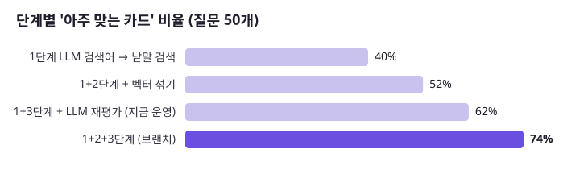
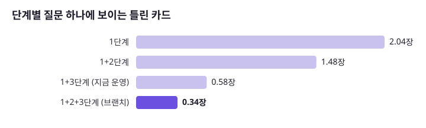
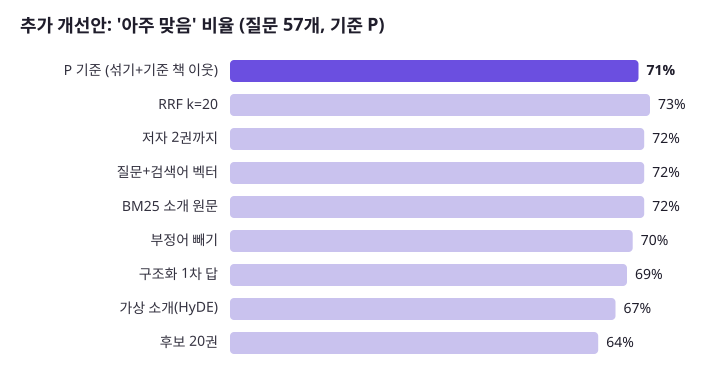

# AI 책 찾기를 어떻게 개선했나: 단계별 숫자와 버린 안 (2026-10-25)

책첵 「AI 책 찾기」를 단계별로 강화하며, 단계마다 **같은 질문·같은 채점표로 숫자를 재서** 넣을 것과 버릴 것을 정한 기록입니다. 방법·지표의 자세한 설명은 [첫 보고서](ai-search-eval-2026-10-25.md), 질문 임베딩 모델을 줄인 과정은 [임베딩 시험 보고서](ai-search-embedding-2026-10-25.md)에 있습니다.

## 1. 단계별로 쌓은 것

| 단계 | 하는 일 | 책첵에서 |
|---|---|---|
| 1단계 | **LLM이 질문을 검색어로 바꿈** → 낱말 검색 | 1차 호출(Haiku)이 검색어·핵심어를 뽑고, PostgreSQL pg_bigm으로 3만 939권의 「제목·저자·한 줄 소개」에서 찾음 |
| 2단계 | **+ 벡터 검색** (문장 뜻으로 찾기) | 질문을 KURE-v1(한국어 임베딩, int8로 줄임)으로 벡터로 바꿔 책 벡터와 비교, 낱말 후보와 RRF로 섞음 |
| 3단계 | **+ LLM 재평가** (후보를 다시 읽고 고름) | 2차 호출(Haiku)이 후보 30권의 제목·저자·한 줄을 읽고 0~3점 적합도를 매겨 2점 이상만 최대 8권 |

실제로 만든 순서는 **1 → 3 → 2**입니다. 3단계까지 운영에 올린 뒤, 숫자로 약점(뜻으로 묻는 질문: 맞음 82%)을 찾아 2단계를 끼워 넣었습니다.

### 단계별 숫자 (질문 50개, 같은 채점표)

| 단계 | 맞음 | **아주 맞음** | **틀린 카드/질문** |
|---|---|---|---|
| 1단계만 (낱말 검색, 순서대로 8권) | 74% | 40% | 2.04 |
| 1+2단계 (낱말+벡터, 순서대로 8권) | 82% | 52% | 1.48 |
| 1+3단계 (지금 운영) | 92~94% | 62% | 0.48~0.68 |
| **1+2+3단계** (운영 코드, 브랜치) | **96%** | **74%** | **0.34** |

- 「맞음」 = 보이는 카드 중 질문의 중심 주제가 맞는 책(채점 2~3점), 「아주 맞음」 = 주제와 조건(대상·쉬움·나라·장르)이 다 맞는 책(3점).
- 「순서대로 8권」은 LLM 재평가 없이 후보 순위 앞 8권을 그대로 보인 경우입니다(실제로 2차 호출이 실패할 때의 대신 답).
- 1단계만 쓸 때보다 **아주 맞는 카드 40% → 74%, 틀린 카드 2.04 → 0.34장(약 1/6)**.
- 같은 날 따로 넣은 「○○ 같은 책」 처리(질문에서 책 제목을 찾아 그 책의 이웃 책을 먼저): 해당 질문 9개에서 아주 맞음 22% → 35%.

## 2. 더 해 본 안 9가지와 결과

기준(P)은 1+2+3단계 운영 코드와 같은 방식입니다. 질문 57개(비슷한 책 질문 포함), 한 번씩 재서 **3%p 이내는 흔들림**으로 봅니다(같은 입력을 두 번 돌려 잰 폭).

| 안 | 바꾼 것 | 아주 맞음 | 틀린 카드 | 2차 입력 | 판단 |
|---|---|---|---|---|---|
| **P 기준** | 섞기 + 기준 책 이웃, 후보 30 | **71%** | **0.40** | 4,226자 | — |
| RRF k=20 | 앞 순위에 더 큰 점수 | 73% | 0.44 | 같음 | 흔들림 안 |
| 저자 2권까지 | 한 저자 책이 몰리지 않게 | 72% | 0.39 | 같음 | 흔들림 안 (카드 저자 수 7.2 → 7.3, 원래 거의 안 몰림) |
| 질문+검색어로 벡터 | 원문 대신 「질문 + 1차 검색어」 | 72% | 0.39 | 같음 | 흔들림 안, 답 없음 1건 |
| BM25 전문 검색 | 책 소개 원문(약 3만 권, 600자)에 BM25를 세 번째 길로 | 72% | 0.42 | 같음 | 흔들림 안 — 벡터가 이미 소개 300자로 만들어져 겹침 |
| 부정어 빼기 | 「뺄 말」이 든 책을 낱말·벡터 후보 뒤로 | 70% | 0.42 | 같음 | 전체 변화 없음(부정어 질문 5개만 70 → 78%) |
| 구조화 1차 답 | 1차가 대상·목적·분야·난이도·뺄 말을 JSON으로 → 벡터 글·입문서 앞으로·뺄 말 뒤로 | 69% | 0.67 | 같음 | **나빠짐** (조건 질문만 84 → 94%) |
| 가상 소개 (HyDE) | 1차가 「딱 맞는 책의 소개」를 지어내 그걸 벡터로 | 67% | 0.51 | 같음 | **나빠짐** (뜻 맞추기 77 → 62%) |
| 후보 20권 | 30 → 20 | 64% | 0.75 | **−33%** | **나빠짐** — 비용을 아끼면 품질이 바로 떨어짐 |

앞선 첫 보고서에서 버린 것: 2차 지시문 고치기(+2~4%p, 흔들림 안), 같은 제목 한 권만(변화 없음), 모든 질문에 이웃 10권 더하기(같은 10칸을 낱말 후보로 채우는 것보다 못함), 벡터만 쓰기(낱말보다 못함).

**정리**: 2단계(섞기)와 「○○ 같은 책」 처리 뒤로는, 검색어·벡터·순위를 이리저리 바꿔도 흔들림을 넘는 개선이 없었습니다. 이 구조에서 남은 차이는 **검색 방법보다 책 쪽 데이터**(한 줄 소개가 없는 3,800여 권, 분류가 없는 3만 권)와 「○○ 같은 책」(아주 맞음 38%)에 있습니다.

## 3. 검색 방식별로 본 지금 상태

| 검색 방식 | 역할 | 책첵 |
|---|---|---|
| 일반 키워드 | 제목·저자·출판사 일치 | 제목·저자 + 한 줄 소개 글자 일치(pg_bigm). 출판사는 안 봄. 제목만 친 질문은 「직접 찾기」로 안내 |
| BM25 전문 검색 | 소개·목차 | 재 봤으나 효과 없음(위 표). 소개 원문은 서버에 두지 않음 |
| 동의어 확장 | AI ↔ 인공지능 ↔ 생성형 AI | 1차 LLM이 같은 뜻의 다른 표현을 검색어에 넣음(사전 없음) |
| 벡터 검색 | 문장 뜻이 비슷한 책 | KURE-v1 int8, 낱말과 RRF 섞기 |
| 필터 | 분야·출판일 등 | 내 도서관(지역)만. 분야는 추천목록 1,900권에만 있음 |
| LLM 재평가 | 후보를 다시 읽고 순위·거르기 | 2차 호출, 적합도 2 이상만 |

## 4. 다음: 책 쪽에 분류 붙이기 (이미 있는 한국어 자료)

분야·대상 필터나 꼬리표를 쓰려면 3만 권에 분류가 있어야 합니다. 새로 사전을 만들기 전에 쓸 수 있는 공개 자료:

| 자료 | 무엇 | 책첵에서 |
|---|---|---|
| **KDC(한국십진분류)** | 도서관 표준 분류(000 총류 … 800 문학, 세 자리 이상) | PC 데이터 폴더의 국립중앙도서관 국가서지 TTL(`data/nlk/ttl`, 7.2GB)에 `kdc` 칸이 있음 → ISBN으로 3만 권에 붙일 수 있는지 셀 차례. 2021년 뒤 책은 비는 경우가 많다는 앞선 기록이 있음(plan-feedback 4616행) |
| **ISBN 부가기호** | ISBN 뒤 다섯 자리: 독자 대상(교양·실용·청소년·아동·전문…) + 발행 형태 + 내용 분류(KDC 기준 세 자리) | 국립중앙도서관 ISBN 서지 API(`EA_ADD_CODE`)로 받음. KAIST 목록 분류에 이미 씀(`4-picks.md`). **「대상 독자」와 「분야」가 한 번에** 나옴 |
| **국립중앙도서관 주제명표목표(NLSH)** | 한국어 표준 주제어 사전. 동의어·상위어·하위어 관계가 있음 | 국가서지 LOD에 책과 연결됨. 「검색용 꼬리표 사전 + 동의어」에 가장 가까움 |
| **Thema** | 출판계 국제 주제 분류(EDItEUR) | 사이클 23 꼬리표 파일에 `thema_code` 칸을 이미 둠 |
| **우리말샘·KorLex** | 국립국어원 개방형 사전(동의어·유의어), 한국어 워드넷 | 동의어 확장 사전으로 쓸 수 있음(API 키 필요) |

온라인 서점의 분야 분류는 약관 문제로 쓰지 않습니다(카카오 도서 API와 같은 이유, 첫 보고서·사이클 23 기록).

## 5. 책 쪽 데이터 보완 (같은 날)

숫자 읽는 법: 질문 하나에 카드 최대 8장. **딱 맞는 카드** = 심사 AI가 「주제도 조건도 맞다」(3점)고 한 장 수, **엉뚱한 카드** = 0~1점 장 수.

| 한 일 | 전 → 후 | 드는 것 | 판단 |
|---|---|---|---|
| **국가서지에서 KDC·대상 뽑기** (`data/nlk/ttl` 7.2GB, ISBN으로 맞춤) | 3만 939권 중 KDC 약 2만 1천 권, 대상(아동·초등·일반…) 약 6,700권. ISBN 있는 2만 4,621권의 92%가 국가서지에 있음 | API 호출 0, PC에서 몇 분 | 쓸 수 있음 |
| **AI 책 프로필** (소개를 읽고 분야·소설 여부·대상·수준·주제어·분위기를 JSON으로, 후보 1,597권) | AI 분야가 KDC와 **80%** 일치(1,269권, 큰 분류 기준) | 하위 에이전트 11묶음 | 분류 품질은 믿을 만함 |
| **2차 AI에게 프로필을 같이 보여 주기** (같은 후보) | 딱 맞는 카드 **5.7 → 5.6장**, 엉뚱한 카드 **0.40 → 0.51장** | 2차 입력 **+42%** | **효과 없음 → 넣지 않음**. 2차 AI는 한 줄 소개만으로 이미 분야·대상을 알아봄 |
| **한 줄 없는 3,841권 채우기** (같은 규칙의 하위 에이전트 20묶음) | **129권만** 채워짐 | 하위 에이전트 20묶음 | 나머지는 아래처럼 뺌 |

**소개가 없거나 잘못된 책은 AI 검색에서 뺌** (사용자 결정, 2026-10-25): 3,712권 — 소개가 비었음 2,728권(중간값 12자), 소개 줄 자체가 없음 864권, **다른 책의 소개가 붙어 있음** 120권(예: 「복권 당첨에 대처하는 올바른 자세」에 소설 수상 소개, 「나는 부동산 싸게 사기로 했다」에 광고기호학 소개 — 수집 데이터의 짝 오류). 목록: 데이터 폴더 `chaekcheck-data/aisearch/excluded-books-2026-10-25.tsv`(번호·이유·제목·저자). 이 책들은 평가에서 후보 1,710자리 중 8자리, 보인 카드 3장(모두 맞음)뿐이라 빼도 숫자 변화는 거의 없고, 한 줄 없이 제목만으로 걸리는 일을 없앰. 운영 반영은 다음 `book-texts` 넣기 때(아직 안 함). 다른 책 소개가 붙은 120권은 수집 쪽에서 고칠 거리(사이클 23 소개 시험 기록과 함께 볼 것)

**정리**: 책 쪽에 분류를 붙이는 일은 **할 수 있고 품질도 괜찮지만(KDC와 80%), 지금 2차 AI 앞에 더하는 것만으로는 카드가 나아지지 않았습니다.** 분류가 효과를 낼 곳은 후보 단계(「청소년」「소설 말고」처럼 낱말로 못 잡는 조건을 칸으로 거르기)인데, 그러려면 3만 권 전체에 프로필이 있어야 해서 이번에는 재지 않았습니다.

## 6. 다시 돌리는 법

첫 보고서 7절 도구에 이번 안을 더함: `nlk_kdc.py`(국가서지에서 KDC·대상·주제명 코드), `profile-RULES.md`(책 프로필 지시문), `cands_more.py`(기준 P와 6안), `cands_more2.py`(BM25·구조화), `qvec_more.py`(가상 소개·질문+검색어·구조화 벡터), `more_score2.py 폴더`(점수). 데이터는 `data/aisearch-eval-2026-10-25/`(`more/`, `hyde.json`, `kw-struct.json`).
