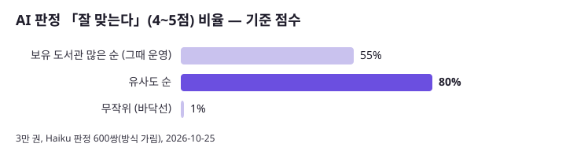
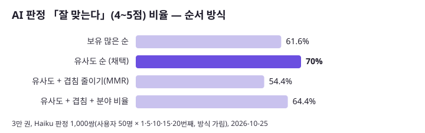
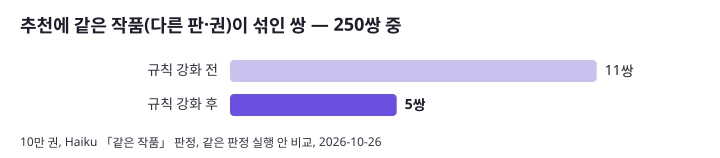
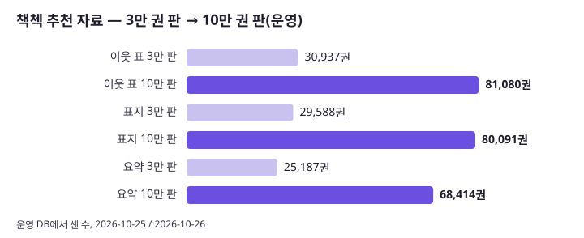

# 책첵 추천 개발·개선 기록 (포트폴리오용)

책첵 「책첵 추천」 탭(사이클 23, 처음 이름 「나에게 맞는 책」)을 만들고 고치며 잰 **모든 전후 숫자를 한 곳에** 모은 문서입니다. 근거·사용자 발언·세부는 [`docs/plan-feedback.md`](../plan-feedback.md)의 「# 사이클 23」「# 사이클 23 (이어서, 2026-10-26~27)」 절, 그림은 [`foryou-eval/`](foryou-eval/), 다시 돌리는 도구는 [`scripts/foryou/eval/`](../../scripts/foryou/eval/)에 있습니다. 공개용 한 장 요약: https://claude.ai/artifact/HEoeTqicrZSPMh3qyVYmfp (원본 [`foryou-portfolio-page.html`](foryou-portfolio-page.html))

## 지금 운영 (2026-10-28, 앱 v1.19.0 · 책첵 추천 코드 v1.15.1 · 자료 2026-10-26 10만 권 판)

- **개인 신호는 브라우저에만**: 본 책 기록(열기 1·10초 머묾 2·도서관 누름 3점, 30일·200권)은 `localStorage`. 서버로는 기준 책 번호 ≤ 6과 다시 보여 줄 책 번호 ≤ 6만 감
- **후보**: 기준 책마다 KURE-v1 임베딩 이웃 20권(PC에서 미리 계산, `foryou.book_neighbour` 81,080권)
- **순서**: 기준 책들의 1순위 이웃을 돌아가며, 그다음 2순위 … (`SimilarOrder.byCloseness`). 같은 작품·기준 책 빼고 **내 도서관 1곳 이상이 가진 책만**, 최대 60권
- **기본 목록**: 추천목록 책(KAIST·서울대·노벨 등)을 보유 도서관 많은 순(운영은 새벽 인기 계산이 꺼져 있음)
- **화면**: KAIST 탭 꼴(분류 칩 + 표지 격자), 칩은 사람마다(그 사람 목록에 책이 있는 분야만, 많이 본 분야부터). 본 책 3권 미만이면 분야를 돌아가며 섞고, 3권 이상이면 10번째부터 15권마다 안 본 분야 책 1권
- **자료**: 표지 80,091권, 해요체 요약 68,414권(Haiku), 분야 6묶음(추천목록 분야 + 이웃 투표 짐작)

## 한눈에 보기

| 무엇을 | 전 → 후 | 어디서 잼 |
|---|---|---|
| 개인 추천 순서: 보유 많은 순 → 유사도 순 (v1.15.1) | 맞힘 Hit@20 **16.8 → 31.8%**, AI 판정 4~5점 **61.6 → 70.0%**(1차 판정 55 → 80%), 흔한 책 **43.5 → 10.7%**, 분야 고르기 **0.69 → 0.77** | 맞힘 220번, 가상 사용자 1,000명, Haiku 판정 1,000쌍, 5·6절 |
| 겹침 줄이기(MMR)·분야 비율 맞추기 | 넣지 않음: MMR은 판정 **54.4%**(보유 순보다 낮음), 분야 비율은 맞힘이 목록 책 치우침으로 부풀려짐 | 6-2절 |
| 대상 책 3만 → 10만 권 범위 | AI 판정 평균 **3.58 → 3.76**, 4~5점 **61.6 → 68.8%**, 1~2점 **16.4 → 12.0%** | 방식 가린 500쌍, 6-3절 |
| 같은 작품 규칙 강화 | 추천에 같은 작품이 섞인 쌍 **11 → 5 / 250**, 판정 평균 그대로(3.79 → 3.77) | 방식 가린 500쌍, 6-4절 |
| 자료 늘리기(운영) | 이웃 **30,937 → 81,080**권, 표지 **29,588 → 80,091**, 요약 **25,187 → 68,414** | 운영 DB, 4절 |
| AI 검색이 쓰는 이웃 (10만 권 표를 넣은 뒤) | 책마다 쓸 수 있는 이웃 **19.85 → 9.47 → 19.82**권(AI 검색 범위도 10만 권으로 맞춘 뒤) | 운영 DB, 6-5절 |
| 3만 권 요약 다시 쓰기(해요체) | **25,187권**, Haiku 하위 에이전트 26개(1,000권씩), 약 1시간, API 키 없음 | 4-2절 |




## 1. 문제와 제약

| 제약 | 그래서 정한 설계 |
|---|---|
| 로그인 없이도 써야 함. 이용 기록(책 열기·도서관 누름·추천 화면)은 서버 `usagelog`에 남고, 로그인한 회원은 회원 번호도 함께(ADR-0134, 1년, 탈퇴 때 비움), 로그인 안 한 사람은 탭 단위 방문 번호만 | 책첵 추천은 **로그인 여부와 상관없이** 브라우저의 본 책 기록(`localStorage`)만 읽고, 서버로는 책 번호 몇 개만 보냄. 서버의 회원 기록은 아직 추천에 쓰지 않음(로그인 회원 맞춤은 다음 일) |
| 공개 초기라 행동 데이터가 적음 | 협업 필터링 대신 **책 내용(임베딩)**으로 비슷함을 계산(내용 기반 추천) |
| 운영 서버가 작음(ARM 2코어, 메모리 약 1.8GB, 백엔드 힙 수백 MB) | 임베딩·이웃은 PC에서 미리 계산, 서버는 표만 읽음 |
| 도서관마다 가진 책이 다름 | 사용자가 고른 지역·도서관이 가진 책만 보냄 |

## 2. 구조

```
[PC]  서지 + 소개 앞 300자 → KURE-v1(1,024차원) → 코사인 이웃 200 → 같은 작품 빼기 → 20권
      → neighbours.tsv(첫 줄 export_id) → collection-import neighbours full → foryou.book_neighbour
[브라우저]  본 책 기록(점수) → 기준 책 6권(한 분야 ≤ 2) + 다시 보여 줄 책 ≤ 6
[서버]  GET /api/v1/for-you/books          기본 목록(추천목록 책, 보유 순), 내 도서관 책만
        GET /api/v1/for-you/similar-books  이웃을 유사도 순으로, 같은 작품·기준 책 빼고, 내 도서관 책만, ≤ 60
[브라우저]  개인 추천 → 기본 목록, 본 책 빼기, 같은 저자 3연속 금지, 8·16번째 다시 보여 주기,
            분야 섞기(본 책 < 3) / 안 본 분야 한 권(본 책 ≥ 3, 10번째부터 15권마다), 칩, 20권씩 더 보기
```

## 3. 설계 결정

- **이웃에 쓸 글**: 제목만으로는 내용을 모름(「코스모스」). 서지 + 소개 앞 300자. 사전 시험에서 소개를 넣으면 이웃이 내용 쪽으로 바뀌었고(「하나의 세포로부터」 → 생물학 책), 계산은 약 4.8배 느려짐(1,000권 475초) — [`cycle23-intro-test-2026-10-25.md`](cycle23-intro-test-2026-10-25.md)
- **소개 없는 책은 대상에서 뺌**: 보유 많은 순 10만 권 중 소개 50자 이상만(약 2.3만 권 뺌)
- **같은 작품 빼기**: 괄호·부제·권 번호·"volume N"·앞뒤 연도·붙은 대시 뒤 부제를 뗀 제목 + 첫 저자. 같은 저자면 한 제목이 다른 제목을 품거나(3자+) 앞 2자+·끝 4자+가 같아도 같은 작품. 코사인으로는 못 가름(같은 작품 쌍도 0.68~0.78, 보통 이웃과 같음)
- **처음 온 사람**: 본 책이 없으면 개인 추천을 묻지 않음. 3권 미만이면 분야를 돌아가며 섞음
- **질리지 않게**: 기준 책 한 분야 ≤ 2권, 본 책 3권 이상이면 15권마다 한 번도 안 본 분야 책 1권(사용자 "아주 가끔")
- **화면**: KAIST 탭과 같은 칩 + 표지 격자(사용자 시안 승인), 요약은 책 창에서. 분야 칩은 독자 말(소설·에세이, 마음·자기계발, 역사·철학, 세상·경제, 과학·기술, 예술·취미)
- **문구 덜어 내기**: 「AI가 골랐어요」 줄, 이동진 관련 안내, 「○○ 추천목록에 있어요」 줄을 사용자 요청으로 뺌

## 4. 자료

### 4-1. 이웃 표

| 판 | 대상 | 행 | 날짜 |
|---|---|---|---|
| 1차 | 추천목록 책 2,007권끼리 | 2,007 | 2026-10-25 |
| 3만 판 | + 보유 많은 3만 권 | 30,937 | 2026-10-25 |
| **10만 판(운영)** | 보유 많은 순 10만 권 중 소개 50자 이상 80,549 + 추천목록 | **81,080** | 2026-10-26 |

10만 권 벡터는 수집 PC 세션이 만듦(새 50,549권 약 7~8시간, CPU). 이웃 계산은 행마다 가까운 200권을 먼저 보고 모자랄 때만 전체를 정렬해 8만 권 × 8만 권을 PC에서 처리.

### 4-2. 요약(해요체 한두 문장)

| 묶음 | 권수 | 만든 방법 | 검사 |
|---|---|---|---|
| 3만 권 | 25,187 | 이 세션의 Haiku 하위 에이전트 26개 × 1,000권, 약 1시간, API 키 없음. 걸린 9권은 직접 씀 | 해요체로 끝남, 40~200자, 칭찬 말(최고의·필독 등) 없음 |
| 10만 권 새 책 | 43,227 | 수집 PC 세션의 Haiku 배치(AI 검색 한 줄·프로필과 합쳐 $34.34) | 같은 검사 + 원문 8자 베낌 금지. 이 세션이 다시 검사: 43,227/43,227 통과 |
| 없음 | 12,666 | — | 검사 탈락 8,571(원문 베낌 5,557, 정보 없음 2,153, 길이 596, 금지어 244 …) + 3만 권 때부터 없던 약 3,330 + 추천목록 761 |

### 4-3. 표지

수집 PC의 표지 받기 결과(`covers.sqlite`)를 재사용, 새로 받지 않음. 10만 권 범위 82,914권 중 받음 80,078(대기 435, 없음 681), 운영에 새 파일 50,490개(약 560MB)를 올려 81,451개.

## 5. 평가 방법

사용자 기록이 쌓이기 전에도 비교할 수 있게 오프라인 시험 세 가지를 만들었습니다(도구: [`scripts/foryou/eval/`](../../scripts/foryou/eval/)).

1. **맞힘 시험**: 사람이 고른 추천목록의 한 분야(KAIST는 연도까지, 22묶음)에서 3권을 "본 책"으로 두고 같은 묶음의 나머지가 추천 20권 안에 나오는지, 220번. 지표 Hit@20·Precision@20·nDCG@20
2. **가상 사용자 1,000명**: 서로 다른 분야의 추천목록 책 3~6권을 본 사람. 지표 분야 고르기(정규화 엔트로피 0~1), 흔한 책 비율(보유 상위 10%), 같은 저자 비율, 목록 안 비슷함(20권끼리 평균 코사인), 1,000명에게 나온 책 수
3. **AI 판정**: (본 책, 추천 책) 쌍을 **어느 방식인지 가린 채** Haiku 하위 에이전트가 1~5점과 「같은 작품」 0/1. 비교는 같은 판정 실행 안에서만(실행마다 0.1~0.3점 흔들림)

## 6. 결과

### 6-1. 기준 점수 (2026-10-25, 3만 권)

| 지표 | 보유 많은 순(그때 운영) | 유사도 순 | 무작위 |
|---|---|---|---|
| Hit@20 | 16.8% | 31.8% | 2.7% |
| Precision@20 | 0.93% | 2.30% | 0.16% |
| nDCG@20 | 0.016 | 0.026 | 0.002 |
| AI 판정 평균(1~5) | 3.59 | 4.10 | 1.37 |
| AI 판정 4~5점 | 55% | 80% | 1% |
| AI 판정 1~2점 | 19% | 10.5% | 93.5% |
| 분야 고르기(0~1) | 0.69 | 0.77 | 0.46 |
| 평균 보유 도서관 수 | 263 | 144 | 140 |
| 흔한 책(보유 상위 10%) | 43.5% | 10.7% | 10.0% |
| 1,000명에게 나온 책 | 4,217 | 5,943 | 14,789 |

이웃 표 자체: 같은 분야 이웃 69.6%, 같은 작품 0%(그때 규칙), 앞 5 이웃 중 같은 저자 20.9%. **찾은 것**: 운영은 새벽 점수가 없어 이웃을 "얼마나 비슷한가"가 아니라 "몇 개 도서관이 가졌나"로만 늘어놓고 있었음 — 코드로는 안 보이던 문제가 숫자로 드러남.


### 6-2. 순서 방식 9가지 (2026-10-25, 3만 권)

| 방식 | Hit@20 | 분야 고르기 | 목록 안 비슷함 | 같은 저자 | 흔한 책 | 목록 책 | AI 판정 평균 | 4~5점 |
|---|---|---|---|---|---|---|---|---|
| 보유 많은 순 | 16.8% | 0.69 | 0.458 | 15.5% | 43.5% | 13.3% | 3.75 | 61.6% |
| **유사도 순(채택)** | 31.8% | 0.77 | 0.443 | 18.5% | 10.7% | 14.8% | **3.90** | **70.0%** |
| 여러 기준 책에 가까운 순(RRF) | 28.6% | 0.77 | 0.443 | 18.4% | 10.8% | 14.7% | — | — |
| 유사도 + 겹침 줄이기 | 34.1% | 0.75 | 0.441 | 0% | 9.4% | 13.5% | 3.60 | 54.4% |
| 유사도 + 분야 비율 | 53.6% | 0.84 | 0.443 | 16.3% | 10.3% | 20.9% | — | — |
| 유사도 + 겹침 + 분야 | 47.3% | 0.86 | 0.440 | 0% | 9.3% | 17.0% | 3.81 | 64.4% |
| 유사도 + 분야(모르는 분야 통과) | 35.9% | 0.75 | 0.443 | 18.3% | 10.7% | 13.6% | — | — |
| (참고) 벡터 MMR λ0.7 | 34.1% | 0.73 | 0.454 | 13.1% | 10.2% | 14.0% | — | — |
| 무작위 | 1.8% | 0.45 | 0.381 | 1.6% | 10.2% | 5.9% | — | — |

- **분야 비율의 높은 맞힘은 치우침**: 맞힘의 정답이 추천목록 책뿐인데, 분야를 아는 책 = 추천목록 책을 앞으로 당겨 목록 책 비율이 14.8 → 20.9%. 모르는 분야를 통과시키면 35.9%로 내려옴
- **겹침 줄이기는 오히려 나쁨**: 같은 저자를 0%로 만들지만 덜 맞는 책을 앞으로 올려 판정이 보유 순보다도 낮음
- **「목록 안 비슷함」은 방식끼리 차이가 거의 없음(0.44~0.46)** — 질림을 가르는 지표로는 약함
- 결정: 가장 단순한 유사도 순. 질림 방지는 화면 쪽 규칙(같은 저자 3연속 금지, 분야 섞기, 가끔 안 본 분야)에 맡김

### 6-3. 대상 3만 → 10만 권 (2026-10-26)

| 지표(유사도 순) | 3만 권 | 10만 권 |
|---|---|---|
| AI 판정 평균 | 3.58 | **3.76** |
| AI 판정 4~5점 | 61.6% | **68.8%** |
| AI 판정 1~2점 | 16.4% | **12.0%** |
| Hit@20 | 31.8% | 15.5% |
| 분야 고르기 | 0.77 | 0.59 |
| 흔한 책 | 10.7% | 16.6% |
| 1,000명에게 나온 책 | 5,943 | 6,757 |

Hit@20·분야 고르기가 내려간 것은 지표의 한계: 정답이 추천목록 책뿐이라 후보가 늘면 목록 책 비율이 14.8 → 8.6%로 떨어지고, 목록 밖 책 중 분야를 짐작한 비율도 21.4 → 6.7%로 줄어 「모름」이 늘었음. 치우침 없는 AI 판정으로는 10만 권이 더 맞음.


### 6-4. 같은 작품 규칙 강화 (2026-10-26)

| | 규칙 전 | 규칙 후 |
|---|---|---|
| 「같은 작품」 판정 쌍 / 250 | 11 | **5** |
| AI 판정 평균 | 3.79 | 3.77 |
| AI 판정 4~5점 | 68.8% | 69.2% |

- 잡은 것: 「십팔사략 volume 1~6」, 연도판(「2023·2025 한국이 열광할 세계 트렌드」), 「삼국지(20)-…」 권들, 「라만차 돈키호테」 ↔ 「라만차의 비범한 이달고 돈키호테」. 이웃이 바뀐 책 17,202권
- 남은 것: 다른 제목 번역판(「명상록」의 현대식 제목판), 앞 글자가 다른 판(「한 권으로 읽는 라 만차의 돈키호테」), 저자 칸이 다른 연도판, 판정이 애매한 다른 책 2



### 6-5. AI 검색과 함께 쓰는 이웃

AI 검색은 「○○ 같은 책」(최대 20권)과 이어 묻기(최대 12권)에 같은 이웃 표를 쓰되 자기 책(`aisearch.search_book`)에 있는 이웃만 씀. 10만 권 이웃 표를 넣자 AI 검색 27,227권의 쓸 수 있는 이웃이 평균 **19.85 → 9.47**(3개 이하 18 → 899권)로 줄었고, AI 검색도 10만 권(76,759권)으로 맞추자 **19.82**(3개 이하 10권)로 돌아옴. 「달러구트 꿈 백화점 같은 판타지 소설」 카드 6 → 8장(24 세션 확인).



## 7. 운영 반영 기록

| 버전·날짜 | 바뀐 것 |
|---|---|
| v1.11.0 (2026-10-25) | 새 탭 「나에게 맞는 책」: 추천목록 책 + 본 책의 이웃 |
| 2026-10-25 | 운영 탭 표지 29,586장(331MB), 3만 권 이웃 표 |
| v1.13.0 (2026-10-25) | 이름 「책첵 추천」, 메인 「더 보기」 연결, 기준 책 6권·분야 섞기, 기준 책 화면을 마이페이지로, 이동진 안내 뺌 |
| v1.14.0 (2026-10-25) | KAIST 탭 꼴(칩 + 격자), 사람마다 다른 칩, 이웃으로 분야 짐작, 가끔 안 본 분야. 3만 권 요약 25,187권(해요체) |
| v1.14.1 (2026-10-25) | 「AI가 골랐어요」 줄 뺌 |
| v1.14.2 (2026-10-25) | 책 창에 요약이 안 보이던 것 고침 |
| v1.15.1 (2026-10-25) | 개인 추천을 유사도 순으로 |
| 2026-10-26 (자료만) | 10만 권: 이웃 81,080, 표지 80,091, 요약 68,414. 같은 작품 규칙 강화 |

## 8. 한계와 배운 점

- **맞힘 시험의 정답은 추천목록 책뿐** → 대상이 넓어지거나 목록 책을 당기는 방식에서 왜곡. 방식 비교는 방식을 가린 AI 판정으로 다시 확인해야 했음
- **AI 판정은 모델 하나의 눈**이고 실행마다 흔들림(같은 3만 판이 3.90·3.58) → 같은 실행 안에서만 비교. 판정 쌍 절반가량은 한쪽 소개가 없어 제목·저자만으로 판단
- **오프라인 점수는 실제 클릭을 대신하지 못함** → 운영 기록(책 열기, 도서관 누름)·A/B로 확인할 일이 남음
- **코사인으로는 같은 작품을 못 가름** → 제목·저자 규칙, 다른 제목 번역판은 아직 못 잡음
- **지표가 문제를 드러냄**: "보유 순으로 늘어놓고 있었다"는 코드 읽기로는 못 보고 숫자로 찾음. 반대로 「분야 비율」처럼 숫자가 좋아 보여도 치우침일 수 있음
- **LLM 글 만들기는 하위 에이전트로**: 2.5만 권 요약을 API 키 없이 1시간에. 결과는 반드시 스크립트로 검사

## 9. 다음

- **사이클 26**: 요약·표지·꼬리표·책 프로필을 `catalog` 한 곳으로(추천목록 요약 파일 없앰, 요약 한 종류). dev 26이 책첵 추천 쪽도 고침
- **머신러닝 보강(26 뒤, plan 요청 2026-10-28)**: ① 책 벡터 하나로 ② Haiku 프로필 7.7만 권을 정답으로 칸별 분류기(확신 낮은 책만 Haiku) → 「마음·자기계발」 칩·목록 밖 분야 채우기 ③ 프로필 오류 찾기(이웃 분야·교차 예측·KDC 중 둘 이상) ④ 군집으로 사전에 없는 주제 찾기 ⑤ 같은 작품·주제 묶음. 결과는 이 문서와 plan-feedback 「# 머신러닝 보강」에
- 운영 지표: 책 창의 도서관 누름에 책첵 추천 구분, 칩 누름, 브라우저별 A/B
- 요약 없는 12,666권 채우기

머신러닝 보강의 방법·이유·시험 설계와 데이터 점검 숫자: [`foryou-ml-method-2026-10-28.md`](foryou-ml-method-2026-10-28.md)

## 10. 다시 돌리기

- 이웃: `<data>/ml/venv/Scripts/python.exe -X utf8 scripts/crawl/foryou_neighbours.py --with-pool --pool pool-100000-intro --out <data>/ml/foryou-100k` → 운영 넣기는 [`docs/maintenance/7-foryou.md`](../maintenance/7-foryou.md) 2절
- 표지: `python -X utf8 scripts/crawl/cover_scope.py count|export --pool pool-100000-intro`
- 평가: [`scripts/foryou/eval/README.md`](../../scripts/foryou/eval/README.md), 그림 `python -X utf8 scripts/foryou/eval/make_charts.py`
